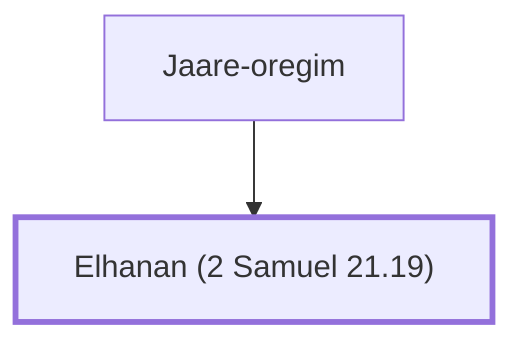

# Elhanan (2 Samuel 21.19)

Warrior from Bethlehem who killed Goliath's brother Lahmi

**Original-language names:** אֶלְחָנָן (H0445)

## When

- **Placed around:** [[connections/timeline/11th century BC|1018 BC]] *(Ussher: the median date of the passages naming them)*

## Family

- **Father:** [[connections/people/Jaare-oregim|Jaare-oregim]]

**Family group:** [[connections/genealogy/Family of Jaare-oregim|Family of Jaare-oregim]], generation 2

## Appears in

[[connections/chapters/10-2-samuel/2 Samuel 21|2 Samuel 21]] · [[connections/chapters/13-1-chronicles/1 Chronicles 20|1 Chronicles 20]]

## Appears in the same verse as

[[connections/people/Goliath|Goliath (2)]] · [[connections/people/Jaare-oregim|Jaare-oregim (2)]] · [[connections/people/Lahmi|Lahmi (2)]] · [[connections/places/Gezer|Gezer]]
