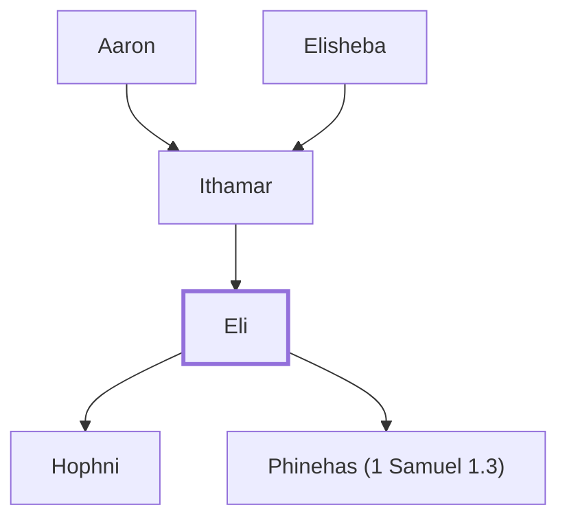

# Eli

High priest and judge of Israel at Shiloh

**Original-language names:** עֵלִי (H5941)

## When

- **Lived:** ? – [[connections/timeline/12th century BC|1122 BC]] *(Jones)*
- **Placed around:** [[connections/timeline/12th century BC|1165 BC]] *(Ussher: the median date of the passages naming them)*

## Family

- **Father:** [[connections/people/Ithamar|Ithamar (ancestor)]]
- **Children:** [[connections/people/Hophni|Hophni]], [[connections/people/Phinehas (1 Samuel 1.3)|Phinehas (1 Samuel 1.3)]]
- **Tribe or nation:** Tribe of Levi

**Family group:** [[connections/genealogy/Family of Adam|Family of Adam]], generation 33

## Events

- [[connections/timeline/12th century BC|1162 BC]] · [[connections/events/Judgeship of Eli|Judgeship of Eli]]
- [[connections/timeline/12th century BC|1122 BC]] · [[connections/events/Death of Eli, Ark Captured|Death of Eli, Ark Captured]]

## Appears in

[[connections/chapters/09-1-samuel/1 Samuel 1|1 Samuel 1 (7)]] · [[connections/chapters/09-1-samuel/1 Samuel 2|1 Samuel 2 (5)]] · [[connections/chapters/09-1-samuel/1 Samuel 3|1 Samuel 3 (10)]] · [[connections/chapters/09-1-samuel/1 Samuel 4|1 Samuel 4 (6)]] · [[connections/chapters/09-1-samuel/1 Samuel 14|1 Samuel 14]] · [[connections/chapters/11-1-kings/1 Kings 2|1 Kings 2]]

## Appears in the same verse as

[[connections/people/Samuel|Samuel (6)]] · [[connections/places/Shiloh|Shiloh (5)]] · [[connections/people/Phinehas (1 Samuel 1.3)|Phinehas (1 Samuel 1.3) (4)]] · [[connections/people/Hophni|Hophni (3)]] · [[connections/people/Elkanah (1 Samuel 1.1)|Elkanah (1 Samuel 1.1) (2)]] · [[connections/people/Hannah|Hannah (2)]] · [[connections/people/Israel|Israel (2)]] · [[connections/people/Abiathar|Abiathar]] · [[connections/people/Ahimelech (1 Samuel 14.3)|Ahimelech (1 Samuel 14.3)]] · [[connections/people/Ahitub (1 Samuel 14.3)|Ahitub (1 Samuel 14.3)]] · [[connections/people/Ichabod|Ichabod]] · [[connections/people/Jonathan (1 Samuel 13.2)|Jonathan (1 Samuel 13.2)]] · [[connections/people/Pharaoh (Exodus 3.10)|Pharaoh (Exodus 3.10)]] · [[connections/people/Solomon|Solomon]] · [[connections/places/Egypt|Egypt]] · [[connections/places/Mizpah|Mizpah]]
