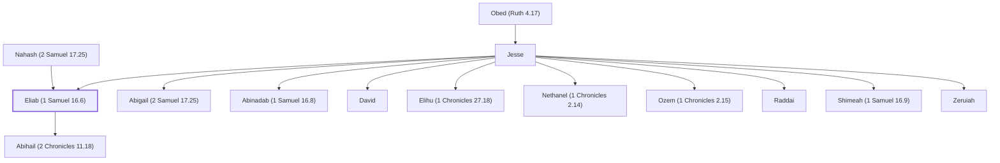

# Eliab (1 Samuel 16.6)

Eldest brother of King David

**Original-language names:** אֱלִיאָב (H0446)

## When

- **Placed around:** [[connections/timeline/11th century BC|1063 BC]] *(Ussher: the median date of the passages naming them)*

## Family

- **Father:** [[connections/people/Jesse|Jesse]]
- **Mother:** [[connections/people/Nahash (2 Samuel 17.25)|Nahash (2 Samuel 17.25)]]
- **Brothers and sisters:** [[connections/people/Abigail (2 Samuel 17.25)|Abigail (2 Samuel 17.25) (uncertain)]], [[connections/people/Abinadab (1 Samuel 16.8)|Abinadab (1 Samuel 16.8)]], [[connections/people/David|David]], [[connections/people/Elihu (1 Chronicles 27.18)|Elihu (1 Chronicles 27.18)]], [[connections/people/Nethanel (1 Chronicles 2.14)|Nethanel (1 Chronicles 2.14)]], [[connections/people/Ozem (1 Chronicles 2.15)|Ozem (1 Chronicles 2.15)]], [[connections/people/Raddai|Raddai]], [[connections/people/Shimeah (1 Samuel 16.9)|Shimeah (1 Samuel 16.9)]], [[connections/people/Zeruiah|Zeruiah]]
- **Children:** [[connections/people/Abihail (2 Chronicles 11.18)|Abihail (2 Chronicles 11.18)]]
- **Tribe or nation:** Tribe of Judah

**Line of descent** (34 generations, father to son): [[connections/people/Adam|Adam]] → [[connections/people/Seth|Seth]] → [[connections/people/Enosh|Enosh]] → [[connections/people/Kenan|Kenan]] → [[connections/people/Mahalalel (Genesis 5.12)|Mahalalel (Genesis 5.12)]] → [[connections/people/Jared|Jared]] → [[connections/people/Enoch (Genesis 5.18)|Enoch (Genesis 5.18)]] → [[connections/people/Methuselah|Methuselah]] → [[connections/people/Lamech (Genesis 5.25)|Lamech (Genesis 5.25)]] → [[connections/people/Noah (Genesis 5.29)|Noah (Genesis 5.29)]] → [[connections/people/Shem|Shem]] → [[connections/people/Arpachshad|Arpachshad]] → [[connections/people/Cainan|Cainan]] → [[connections/people/Shelah (Genesis 10.24)|Shelah (Genesis 10.24)]] → [[connections/people/Eber (Genesis 10.21)|Eber (Genesis 10.21)]] → [[connections/people/Peleg|Peleg]] → [[connections/people/Reu|Reu]] → [[connections/people/Serug|Serug]] → [[connections/people/Nahor (Genesis 11.22)|Nahor (Genesis 11.22)]] → [[connections/people/Terah|Terah]] → [[connections/people/Abraham|Abraham]] → [[connections/people/Isaac|Isaac]] → [[connections/people/Israel|Israel]] → [[connections/people/Judah (Genesis 29.35)|Judah (Genesis 29.35)]] → [[connections/people/Perez|Perez]] → [[connections/people/Hezron (Genesis 46.12)|Hezron (Genesis 46.12)]] → [[connections/people/Ram (Ruth 4.19)|Ram (Ruth 4.19)]] → [[connections/people/Amminadab (Exodus 6.23)|Amminadab (Exodus 6.23)]] → [[connections/people/Nahshon|Nahshon]] → [[connections/people/Salmon|Salmon]] → [[connections/people/Boaz|Boaz]] → [[connections/people/Obed (Ruth 4.17)|Obed (Ruth 4.17)]] → [[connections/people/Jesse|Jesse]] → **Eliab (1 Samuel 16.6)**

**Family group:** [[connections/genealogy/Family of Adam|Family of Adam]], generation 34

## Appears in

[[connections/chapters/09-1-samuel/1 Samuel 16|1 Samuel 16]] · [[connections/chapters/09-1-samuel/1 Samuel 17|1 Samuel 17 (2)]] · [[connections/chapters/13-1-chronicles/1 Chronicles 2|1 Chronicles 2]] · [[connections/chapters/14-2-chronicles/2 Chronicles 11|2 Chronicles 11]]

## Appears in the same verse as

[[connections/people/Jesse|Jesse (3)]] · [[connections/people/Abinadab (1 Samuel 16.8)|Abinadab (1 Samuel 16.8) (2)]] · [[connections/people/David|David (2)]] · [[connections/people/Shimeah (1 Samuel 16.9)|Shimeah (1 Samuel 16.9) (2)]] · [[connections/people/Abihail (2 Chronicles 11.18)|Abihail (2 Chronicles 11.18)]] · [[connections/people/Jerimoth (2 Chronicles 11.18)|Jerimoth (2 Chronicles 11.18)]] · [[connections/people/Mahalath (2 Chronicles 11.18)|Mahalath (2 Chronicles 11.18)]] · [[connections/people/Rehoboam|Rehoboam]] · [[connections/people/Saul|Saul]]
