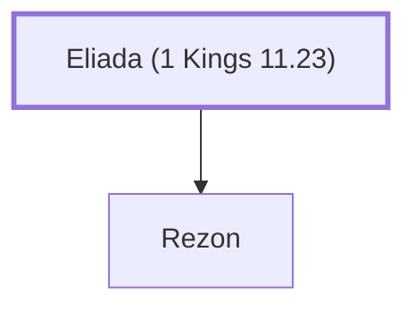

# Eliada (1 Kings 11.23)

Father of Rezon, an adversary of Solomon

**Original-language names:** אֶלְיָדָע (H0450)

## When

- **Placed around:** [[connections/timeline/10th century BC|984 BC]] *(Ussher: the median date of the passages naming them)*

## Family

- **Children:** [[connections/people/Rezon|Rezon]]

**Family group:** [[connections/genealogy/Family of Eliada (1 Kings 11.23)|Family of Eliada (1 Kings 11.23)]], generation 1

## Appears in

[[connections/chapters/11-1-kings/1 Kings 11|1 Kings 11]]

## Appears in the same verse as

[[connections/people/Hadadezer|Hadadezer]] · [[connections/people/Rezon|Rezon]] · [[connections/places/Zobah|Zobah]]
