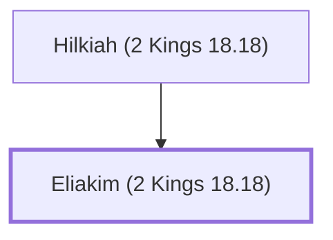

# Eliakim (2 Kings 18.18)

Palace administrator under King Hezekiah

**Original-language names:** אֶלְיָקִים (H0471)

## When

- **Placed around:** [[connections/timeline/8th century BC|710 BC]] *(Ussher: the median date of the passages naming them)*

## Family

- **Father:** [[connections/people/Hilkiah (2 Kings 18.18)|Hilkiah (2 Kings 18.18)]]

**Family group:** [[connections/genealogy/Family of Hilkiah (2 Kings 18.18)|Family of Hilkiah (2 Kings 18.18)]], generation 2

## Appears in

[[connections/chapters/12-2-kings/2 Kings 18|2 Kings 18 (3)]] · [[connections/chapters/12-2-kings/2 Kings 19|2 Kings 19]] · [[connections/chapters/23-isaiah/Isaiah 22|Isaiah 22]] · [[connections/chapters/23-isaiah/Isaiah 36|Isaiah 36 (3)]] · [[connections/chapters/23-isaiah/Isaiah 37|Isaiah 37]]

## Appears in the same verse as

[[connections/people/Shebna|Shebna (8)]] · [[connections/people/Hilkiah (2 Kings 18.18)|Hilkiah (2 Kings 18.18) (6)]] · [[connections/people/Joah (2 Kings 18.18)|Joah (2 Kings 18.18) (6)]] · [[connections/people/Asaph (2 Kings 18.18)|Asaph (2 Kings 18.18) (4)]] · [[connections/people/Rabshakeh|Rabshakeh (4)]] · [[connections/people/Amoz|Amoz (2)]] · [[connections/people/Hezekiah (2 Kings 16.20)|Hezekiah (2 Kings 16.20) (2)]] · [[connections/people/Isaiah|Isaiah (2)]]
