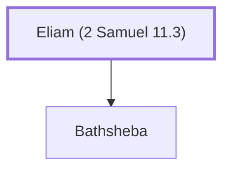

# Eliam (2 Samuel 11.3)

Father of Bathsheba, wife of Uriah the Hittite

**Also called:** Ammiel

**Original-language names:** אֱלִיעָם (H0463) · עַמִּיאֵל (H5988)

## When

- **Placed around:** [[connections/timeline/11th century BC|1035 BC]] *(Ussher: the median date of the passages naming them)*

## Family

- **Children:** [[connections/people/Bathsheba|Bathsheba]]

**Family group:** [[connections/genealogy/Family of Adam|Family of Adam]], generation 1

## Appears in

[[connections/chapters/10-2-samuel/2 Samuel 11|2 Samuel 11]] · [[connections/chapters/13-1-chronicles/1 Chronicles 3|1 Chronicles 3]]

## Appears in the same verse as

[[connections/people/Bathsheba|Bathsheba (2)]] · [[connections/people/David|David]] · [[connections/people/Nathan (2 Samuel 5.14)|Nathan (2 Samuel 5.14)]] · [[connections/people/Shammua (2 Samuel 5.14)|Shammua (2 Samuel 5.14)]] · [[connections/people/Shobab (2 Samuel 5.14)|Shobab (2 Samuel 5.14)]] · [[connections/people/Solomon|Solomon]] · [[connections/people/Uriah (2 Samuel 11.3)|Uriah (2 Samuel 11.3)]] · [[connections/places/Jerusalem|Jerusalem]]
