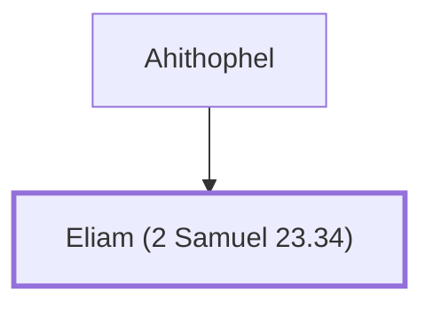

# Eliam (2 Samuel 23.34)

Son of Ahithophel the Gilonite, one of David's mighty men

**Original-language names:** אֱלִיעָם (H0463)

## When

- **Placed around:** [[connections/timeline/11th century BC|1055 BC]] *(Ussher: the median date of the passages naming them)*

## Family

- **Father:** [[connections/people/Ahithophel|Ahithophel]]

**Family group:** [[connections/genealogy/Family of Ahithophel|Family of Ahithophel]], generation 2

## Appears in

[[connections/chapters/10-2-samuel/2 Samuel 23|2 Samuel 23]]

## Appears in the same verse as

[[connections/people/Ahasbai|Ahasbai]] · [[connections/people/Ahithophel|Ahithophel]] · [[connections/people/Eliphelet (2 Samuel 23.34)|Eliphelet (2 Samuel 23.34)]]
