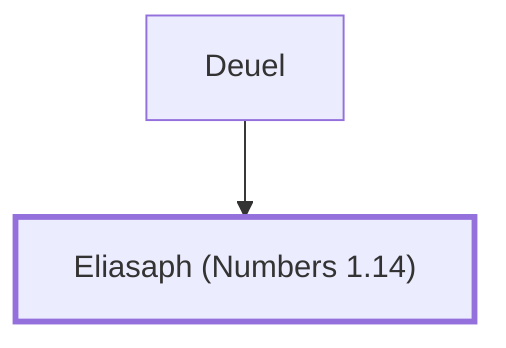

# Eliasaph (Numbers 1.14)

Son of Deuel, leader of the tribe of Gad

**Original-language names:** אֶלְיָסָף (H0460)

## When

- **Placed around:** [[connections/timeline/15th century BC|1490 BC]] *(Ussher: the median date of the passages naming them)*

## Family

- **Father:** [[connections/people/Deuel|Deuel]]
- **Tribe or nation:** Tribe of Gad

**Family group:** [[connections/genealogy/Family of Deuel|Family of Deuel]], generation 2

## Appears in

[[connections/chapters/04-numbers/Numbers 1|Numbers 1]] · [[connections/chapters/04-numbers/Numbers 2|Numbers 2]] · [[connections/chapters/04-numbers/Numbers 7|Numbers 7 (2)]] · [[connections/chapters/04-numbers/Numbers 10|Numbers 10]]

## Appears in the same verse as

[[connections/people/Deuel|Deuel (5)]] · [[connections/people/Gad (Genesis 30.11)|Gad (Genesis 30.11) (4)]]
