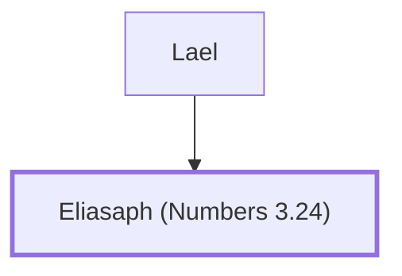

# Eliasaph (Numbers 3.24)

Son of Lael, leader of the Gershonite Levites

**Original-language names:** אֶלְיָסָף (H0460)

## When

- **Placed around:** [[connections/timeline/15th century BC|1490 BC]] *(Ussher: the median date of the passages naming them)*

## Family

- **Father:** [[connections/people/Lael|Lael]]

**Family group:** [[connections/genealogy/Family of Lael|Family of Lael]], generation 2

## Appears in

[[connections/chapters/04-numbers/Numbers 3|Numbers 3]]

## Appears in the same verse as

[[connections/people/Lael|Lael]]
