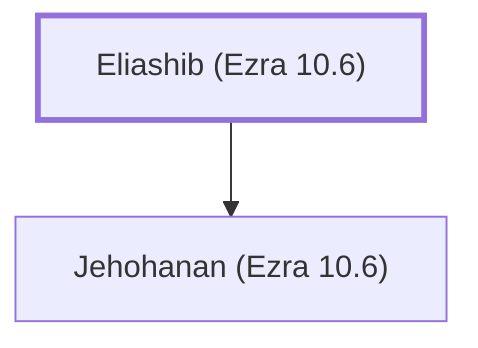

# Eliashib (Ezra 10.6)

Priest during Ezra's time, associated with Jehohanan's chamber

**Original-language names:** אֶלְיָשִׁיב (H0475)

## Family

- **Children:** [[connections/people/Jehohanan (Ezra 10.6)|Jehohanan (Ezra 10.6)]]

**Family group:** [[connections/genealogy/Family of Eliashib (Ezra 10.6)|Family of Eliashib (Ezra 10.6)]], generation 1

## Appears in

[[connections/chapters/15-ezra/Ezra 10|Ezra 10]]

## Appears in the same verse as

[[connections/people/Ezra (Ezra 7.1)|Ezra (Ezra 7.1)]] · [[connections/people/Jehohanan (Ezra 10.6)|Jehohanan (Ezra 10.6)]]
