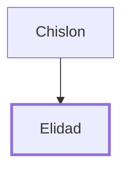

# Elidad

Son of Chislon, leader from the tribe of Benjamin

**Original-language names:** אֱלִידָד (H0449)

## When

- **Placed around:** [[connections/timeline/15th century BC|1452 BC]] *(Ussher: the median date of the passages naming them)*

## Family

- **Father:** [[connections/people/Chislon|Chislon]]

**Family group:** [[connections/genealogy/Family of Chislon|Family of Chislon]], generation 2

## Appears in

[[connections/chapters/04-numbers/Numbers 34|Numbers 34]]

## Appears in the same verse as

[[connections/people/Benjamin (Genesis 35.18)|Benjamin (Genesis 35.18)]] · [[connections/people/Chislon|Chislon]]
