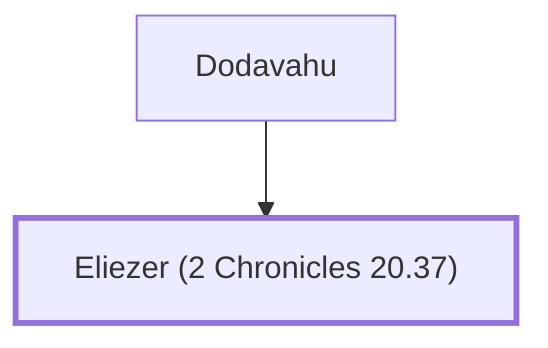

# Eliezer (2 Chronicles 20.37)

A prophet who rebuked King Jehoshaphat.

**Original-language names:** אֱלִיעֶ֫זֶר (H0461)

## When

- **Placed around:** [[connections/timeline/9th century BC|896 BC]] *(Ussher: the median date of the passages naming them)*

## Family

- **Father:** [[connections/people/Dodavahu|Dodavahu]]

**Family group:** [[connections/genealogy/Family of Dodavahu|Family of Dodavahu]], generation 2

## Appears in

[[connections/chapters/14-2-chronicles/2 Chronicles 20|2 Chronicles 20]]

## Appears in the same verse as

[[connections/people/Ahaziah (1 Kings 22.40)|Ahaziah (1 Kings 22.40)]] · [[connections/people/Dodavahu|Dodavahu]] · [[connections/people/Jehoshaphat (1 Kings 15.24)|Jehoshaphat (1 Kings 15.24)]] · [[connections/places/Mareshah|Mareshah]] · [[connections/places/Tarshish|Tarshish]]
