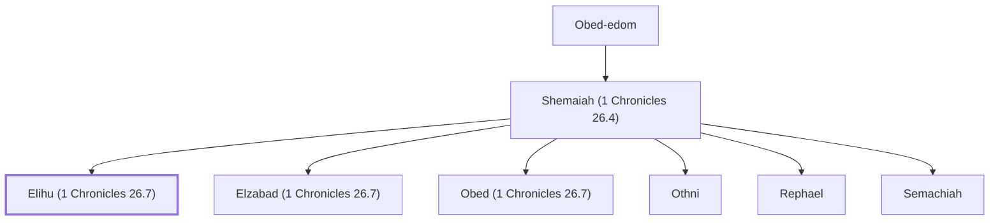

# Elihu (1 Chronicles 26.7)

A gatekeeper of the temple, son of Shemaiah.

**Original-language names:** אֱלִיהוּ (H0453)

## When

- **Placed around:** [[connections/timeline/11th century BC|1015 BC]] *(Ussher: the median date of the passages naming them)*

## Family

- **Father:** [[connections/people/Shemaiah (1 Chronicles 26.4)|Shemaiah (1 Chronicles 26.4)]]
- **Brothers and sisters:** [[connections/people/Elzabad (1 Chronicles 26.7)|Elzabad (1 Chronicles 26.7)]], [[connections/people/Obed (1 Chronicles 26.7)|Obed (1 Chronicles 26.7)]], [[connections/people/Othni|Othni]], [[connections/people/Rephael|Rephael]], [[connections/people/Semachiah|Semachiah]]
- **Tribe or nation:** Tribe of Levi

**Line of descent** (40 generations, father to son): [[connections/people/Adam|Adam]] → [[connections/people/Seth|Seth]] → [[connections/people/Enosh|Enosh]] → [[connections/people/Kenan|Kenan]] → [[connections/people/Mahalalel (Genesis 5.12)|Mahalalel (Genesis 5.12)]] → [[connections/people/Jared|Jared]] → [[connections/people/Enoch (Genesis 5.18)|Enoch (Genesis 5.18)]] → [[connections/people/Methuselah|Methuselah]] → [[connections/people/Lamech (Genesis 5.25)|Lamech (Genesis 5.25)]] → [[connections/people/Noah (Genesis 5.29)|Noah (Genesis 5.29)]] → [[connections/people/Shem|Shem]] → [[connections/people/Arpachshad|Arpachshad]] → [[connections/people/Cainan|Cainan]] → [[connections/people/Shelah (Genesis 10.24)|Shelah (Genesis 10.24)]] → [[connections/people/Eber (Genesis 10.21)|Eber (Genesis 10.21)]] → [[connections/people/Peleg|Peleg]] → [[connections/people/Reu|Reu]] → [[connections/people/Serug|Serug]] → [[connections/people/Nahor (Genesis 11.22)|Nahor (Genesis 11.22)]] → [[connections/people/Terah|Terah]] → [[connections/people/Abraham|Abraham]] → [[connections/people/Isaac|Isaac]] → [[connections/people/Israel|Israel]] → [[connections/people/Levi (Genesis 29.34)|Levi (Genesis 29.34)]] → [[connections/people/Merari|Merari]] → [[connections/people/Mushi|Mushi]] → [[connections/people/Mahli (1 Chronicles 6.32)|Mahli (1 Chronicles 6.32)]] → [[connections/people/Shemer (1 Chronicles 6.31)|Shemer (1 Chronicles 6.31)]] → [[connections/people/Bani (1 Chronicles 6.31)|Bani (1 Chronicles 6.31)]] → [[connections/people/Amzi (1 Chronicles 6.31)|Amzi (1 Chronicles 6.31)]] → [[connections/people/Hilkiah (1 Chronicles 6.30)|Hilkiah (1 Chronicles 6.30)]] → [[connections/people/Amaziah (1 Chronicles 6.30)|Amaziah (1 Chronicles 6.30)]] → [[connections/people/Hashabiah (1 Chronicles 6.30)|Hashabiah (1 Chronicles 6.30)]] → [[connections/people/Malluch (1 Chronicles 6.29)|Malluch (1 Chronicles 6.29)]] → [[connections/people/Abdi (1 Chronicles 6.29)|Abdi (1 Chronicles 6.29)]] → [[connections/people/Kishi|Kishi]] → [[connections/people/Jeduthun (1 Chronicles 6.29)|Jeduthun (1 Chronicles 6.29)]] → [[connections/people/Obed-edom|Obed-edom]] → [[connections/people/Shemaiah (1 Chronicles 26.4)|Shemaiah (1 Chronicles 26.4)]] → **Elihu (1 Chronicles 26.7)**

**Family group:** [[connections/genealogy/Family of Adam|Family of Adam]], generation 40

## Appears in

[[connections/chapters/13-1-chronicles/1 Chronicles 26|1 Chronicles 26]]

## Appears in the same verse as

[[connections/people/Elzabad (1 Chronicles 26.7)|Elzabad (1 Chronicles 26.7)]] · [[connections/people/Obed (1 Chronicles 26.7)|Obed (1 Chronicles 26.7)]] · [[connections/people/Othni|Othni]] · [[connections/people/Rephael|Rephael]] · [[connections/people/Semachiah|Semachiah]] · [[connections/people/Shemaiah (1 Chronicles 26.4)|Shemaiah (1 Chronicles 26.4)]]
