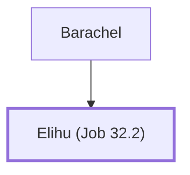

# Elihu (Job 32.2)

A young man who spoke to Job.

**Original-language names:** אֱלִיהוּ (H0453)

## When

- **Placed around:** [[connections/timeline/16th century BC|1520 BC]] *(Ussher: the median date of the passages naming them)*

## Family

- **Father:** [[connections/people/Barachel|Barachel]]

**Family group:** [[connections/genealogy/Family of Barachel|Family of Barachel]], generation 2

## Appears in

[[connections/chapters/18-job/Job 32|Job 32 (4)]] · [[connections/chapters/18-job/Job 34|Job 34]] · [[connections/chapters/18-job/Job 35|Job 35]] · [[connections/chapters/18-job/Job 36|Job 36]]

## Appears in the same verse as

[[connections/people/Barachel|Barachel (2)]] · [[connections/people/Job|Job (2)]] · [[connections/people/Ram (Job 32.2)|Ram (Job 32.2)]]
