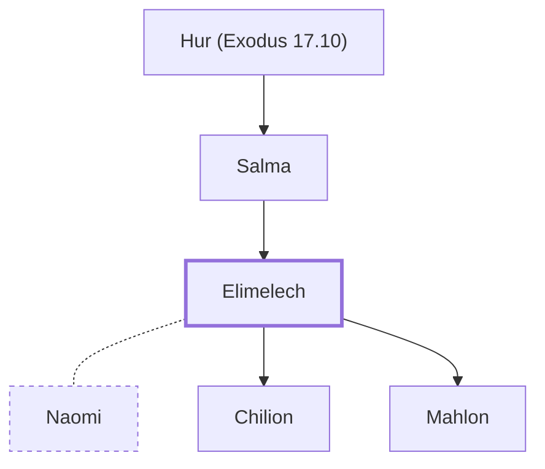

# Elimelech

Naomi's husband from Bethlehem.

**Original-language names:** אֱלִימֶ֫לֶךְ (H0458)

## When

- **Placed around:** [[connections/timeline/14th century BC|1307 BC]] *(Ussher: the median date of the passages naming them)*

## Family

- **Father:** [[connections/people/Salma|Salma (uncertain)]]
- **Spouses:** [[connections/people/Naomi|Naomi]]
- **Children:** [[connections/people/Chilion|Chilion]], [[connections/people/Mahlon|Mahlon]]
- **Tribe or nation:** Tribe of Judah

**Line of descent** (30 generations, father to son): [[connections/people/Adam|Adam]] → [[connections/people/Seth|Seth]] → [[connections/people/Enosh|Enosh]] → [[connections/people/Kenan|Kenan]] → [[connections/people/Mahalalel (Genesis 5.12)|Mahalalel (Genesis 5.12)]] → [[connections/people/Jared|Jared]] → [[connections/people/Enoch (Genesis 5.18)|Enoch (Genesis 5.18)]] → [[connections/people/Methuselah|Methuselah]] → [[connections/people/Lamech (Genesis 5.25)|Lamech (Genesis 5.25)]] → [[connections/people/Noah (Genesis 5.29)|Noah (Genesis 5.29)]] → [[connections/people/Shem|Shem]] → [[connections/people/Arpachshad|Arpachshad]] → [[connections/people/Cainan|Cainan]] → [[connections/people/Shelah (Genesis 10.24)|Shelah (Genesis 10.24)]] → [[connections/people/Eber (Genesis 10.21)|Eber (Genesis 10.21)]] → [[connections/people/Peleg|Peleg]] → [[connections/people/Reu|Reu]] → [[connections/people/Serug|Serug]] → [[connections/people/Nahor (Genesis 11.22)|Nahor (Genesis 11.22)]] → [[connections/people/Terah|Terah]] → [[connections/people/Abraham|Abraham]] → [[connections/people/Isaac|Isaac]] → [[connections/people/Israel|Israel]] → [[connections/people/Judah (Genesis 29.35)|Judah (Genesis 29.35)]] → [[connections/people/Perez|Perez]] → [[connections/people/Hezron (Genesis 46.12)|Hezron (Genesis 46.12)]] → [[connections/people/Caleb (1 Chronicles 2.9)|Caleb (1 Chronicles 2.9)]] → [[connections/people/Hur (Exodus 17.10)|Hur (Exodus 17.10)]] → [[connections/people/Salma|Salma]] → **Elimelech**

**Family group:** [[connections/genealogy/Family of Adam|Family of Adam]], generation 30

## Appears in

[[connections/chapters/08-ruth/Ruth 1|Ruth 1 (2)]] · [[connections/chapters/08-ruth/Ruth 2|Ruth 2 (2)]] · [[connections/chapters/08-ruth/Ruth 4|Ruth 4 (2)]]

## Appears in the same verse as

[[connections/people/Naomi|Naomi (5)]] · [[connections/people/Boaz|Boaz (3)]] · [[connections/people/Chilion|Chilion (2)]] · [[connections/people/Mahlon|Mahlon (2)]] · [[connections/places/Moab|Moab (2)]] · [[connections/people/Judah (Genesis 29.35)|Judah (Genesis 29.35)]] · [[connections/places/Bethlehem (Genesis 35.16)|Bethlehem (Genesis 35.16)]]
