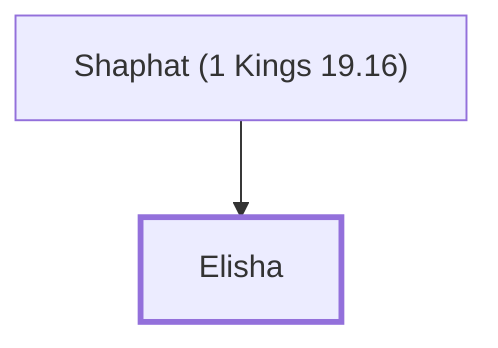

# Elisha

A prophet who succeeded Elijah.

**Original-language names:** אֱלִישָׁע (H0477) · Ἐλισσαῖος (G1666)

## When

- **Placed around:** [[connections/timeline/9th century BC|894 BC]] *(Ussher: the median date of the passages naming them)*

## Family

- **Father:** [[connections/people/Shaphat (1 Kings 19.16)|Shaphat (1 Kings 19.16)]]

**Family group:** [[connections/genealogy/Family of Shaphat (1 Kings 19.16)|Family of Shaphat (1 Kings 19.16)]], generation 2

## Events

- [[connections/timeline/9th century BC|897 BC]] · [[connections/events/Prophecies of Elisha|Prophecies of Elisha]]

## Appears in

[[connections/chapters/11-1-kings/1 Kings 19|1 Kings 19 (3)]] · [[connections/chapters/12-2-kings/2 Kings 2|2 Kings 2 (11)]] · [[connections/chapters/12-2-kings/2 Kings 3|2 Kings 3 (3)]] · [[connections/chapters/12-2-kings/2 Kings 4|2 Kings 4 (6)]] · [[connections/chapters/12-2-kings/2 Kings 5|2 Kings 5 (5)]] · [[connections/chapters/12-2-kings/2 Kings 6|2 Kings 6 (9)]] · [[connections/chapters/12-2-kings/2 Kings 7|2 Kings 7]] · [[connections/chapters/12-2-kings/2 Kings 8|2 Kings 8 (7)]] · [[connections/chapters/12-2-kings/2 Kings 9|2 Kings 9]] · [[connections/chapters/12-2-kings/2 Kings 13|2 Kings 13 (6)]] · [[connections/chapters/42-luke/Luke 4|Luke 4]]

## Appears in the same verse as

[[connections/people/Israel|Israel (10)]] · [[connections/people/Elijah (1 Kings 17.1)|Elijah (1 Kings 17.1) (8)]] · [[connections/people/Gehazi|Gehazi (4)]] · [[connections/people/Shaphat (1 Kings 19.16)|Shaphat (1 Kings 19.16) (4)]] · [[connections/people/Naaman (2 Kings 5.1)|Naaman (2 Kings 5.1) (3)]] · [[connections/places/Jericho|Jericho (3)]] · [[connections/places/Samaria|Samaria (3)]] · [[connections/places/Syria|Syria (3)]] · [[connections/people/Hazael|Hazael (2)]] · [[connections/people/Jehoshaphat (1 Kings 15.24)|Jehoshaphat (1 Kings 15.24) (2)]] · [[connections/people/Jehu (1 Kings 19.16)|Jehu (1 Kings 19.16) (2)]] · [[connections/places/Bethel (Genesis 12.8)|Bethel (Genesis 12.8) (2)]] · [[connections/places/Gilgal (2 Kings 2.1)|Gilgal (2 Kings 2.1) (2)]] · [[connections/places/Moab|Moab (2)]] · [[connections/people/Ben-hadad (2 Kings 6.24)|Ben-hadad (2 Kings 6.24)]] · [[connections/people/Joash (2 Kings 13.9)|Joash (2 Kings 13.9)]] · [[connections/people/Judah (Genesis 29.35)|Judah (Genesis 29.35)]] · [[connections/people/Nimshi|Nimshi]] · [[connections/places/Abel-meholah|Abel-meholah]] · [[connections/places/Aphek (1 Kings 20.26)|Aphek (1 Kings 20.26)]] · [[connections/places/Damascus|Damascus]] · [[connections/places/Jordan|Jordan]] · [[connections/places/Ramoth|Ramoth]] · [[connections/places/Shunem|Shunem]]
