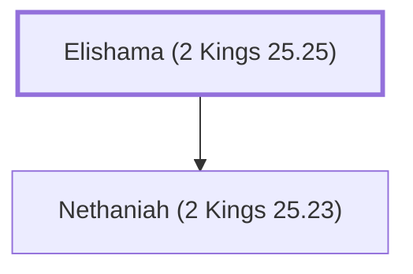

# Elishama (2 Kings 25.25)

Grandfather of Ishmael, who assassinated Gedaliah.

**Original-language names:** אֱלִישָׁמָע (H0476)

## When

- **Placed around:** [[connections/timeline/6th century BC|588 BC]] *(Ussher: the median date of the passages naming them)*

## Family

- **Children:** [[connections/people/Nethaniah (2 Kings 25.23)|Nethaniah (2 Kings 25.23)]]

**Family group:** [[connections/genealogy/Family of Elishama (2 Kings 25.25)|Family of Elishama (2 Kings 25.25)]], generation 1

## Appears in

[[connections/chapters/12-2-kings/2 Kings 25|2 Kings 25]] · [[connections/chapters/24-jeremiah/Jeremiah 41|Jeremiah 41]]

## Appears in the same verse as

[[connections/people/Gedaliah (2 Kings 25.22)|Gedaliah (2 Kings 25.22) (2)]] · [[connections/people/Ishmael (2 Kings 25.23)|Ishmael (2 Kings 25.23) (2)]] · [[connections/people/Nethaniah (2 Kings 25.23)|Nethaniah (2 Kings 25.23) (2)]] · [[connections/places/Mizpah|Mizpah (2)]] · [[connections/people/Ahikam|Ahikam]] · [[connections/places/Chaldea|Chaldea]]
