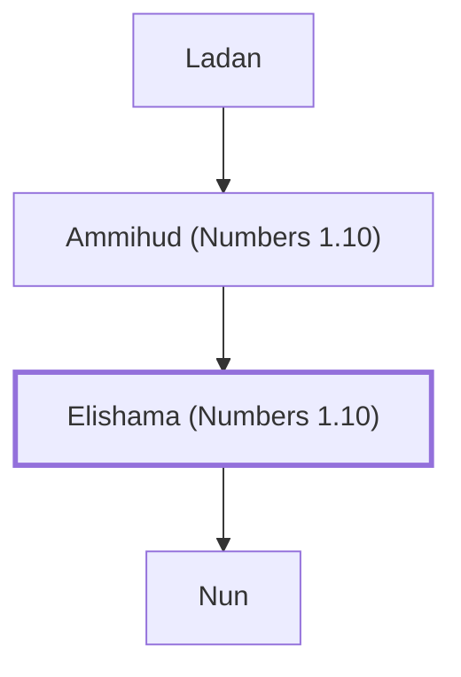

# Elishama (Numbers 1.10)

A leader from the tribe of Ephraim.

**Original-language names:** אֱלִישָׁמָע (H0476)

## When

- **Placed around:** [[connections/timeline/15th century BC|1490 BC]] *(Ussher: the median date of the passages naming them)*

## Family

- **Father:** [[connections/people/Ammihud (Numbers 1.10)|Ammihud (Numbers 1.10)]]
- **Children:** [[connections/people/Nun|Nun]]
- **Tribe or nation:** Tribe of Ephraim

**Line of descent** (32 generations, father to son): [[connections/people/Adam|Adam]] → [[connections/people/Seth|Seth]] → [[connections/people/Enosh|Enosh]] → [[connections/people/Kenan|Kenan]] → [[connections/people/Mahalalel (Genesis 5.12)|Mahalalel (Genesis 5.12)]] → [[connections/people/Jared|Jared]] → [[connections/people/Enoch (Genesis 5.18)|Enoch (Genesis 5.18)]] → [[connections/people/Methuselah|Methuselah]] → [[connections/people/Lamech (Genesis 5.25)|Lamech (Genesis 5.25)]] → [[connections/people/Noah (Genesis 5.29)|Noah (Genesis 5.29)]] → [[connections/people/Shem|Shem]] → [[connections/people/Arpachshad|Arpachshad]] → [[connections/people/Cainan|Cainan]] → [[connections/people/Shelah (Genesis 10.24)|Shelah (Genesis 10.24)]] → [[connections/people/Eber (Genesis 10.21)|Eber (Genesis 10.21)]] → [[connections/people/Peleg|Peleg]] → [[connections/people/Reu|Reu]] → [[connections/people/Serug|Serug]] → [[connections/people/Nahor (Genesis 11.22)|Nahor (Genesis 11.22)]] → [[connections/people/Terah|Terah]] → [[connections/people/Abraham|Abraham]] → [[connections/people/Isaac|Isaac]] → [[connections/people/Israel|Israel]] → [[connections/people/Joseph (Genesis 30.24)|Joseph (Genesis 30.24)]] → [[connections/people/Ephraim|Ephraim]] → [[connections/people/Beriah (1 Chronicles 7.23)|Beriah (1 Chronicles 7.23)]] → [[connections/people/Resheph|Resheph]] → [[connections/people/Telah|Telah]] → [[connections/people/Tahan (1 Chronicles 7.25)|Tahan (1 Chronicles 7.25)]] → [[connections/people/Ladan|Ladan]] → [[connections/people/Ammihud (Numbers 1.10)|Ammihud (Numbers 1.10)]] → **Elishama (Numbers 1.10)**

**Family group:** [[connections/genealogy/Family of Adam|Family of Adam]], generation 32

## Appears in

[[connections/chapters/04-numbers/Numbers 1|Numbers 1]] · [[connections/chapters/04-numbers/Numbers 2|Numbers 2]] · [[connections/chapters/04-numbers/Numbers 7|Numbers 7 (2)]] · [[connections/chapters/04-numbers/Numbers 10|Numbers 10]] · [[connections/chapters/13-1-chronicles/1 Chronicles 7|1 Chronicles 7]]

## Appears in the same verse as

[[connections/people/Ammihud (Numbers 1.10)|Ammihud (Numbers 1.10) (6)]] · [[connections/people/Ephraim|Ephraim (4)]] · [[connections/people/Gamaliel (Numbers 1.10)|Gamaliel (Numbers 1.10)]] · [[connections/people/Joseph (Genesis 30.24)|Joseph (Genesis 30.24)]] · [[connections/people/Ladan|Ladan]] · [[connections/people/Manasseh (Genesis 41.51)|Manasseh (Genesis 41.51)]] · [[connections/people/Pedahzur|Pedahzur]]
