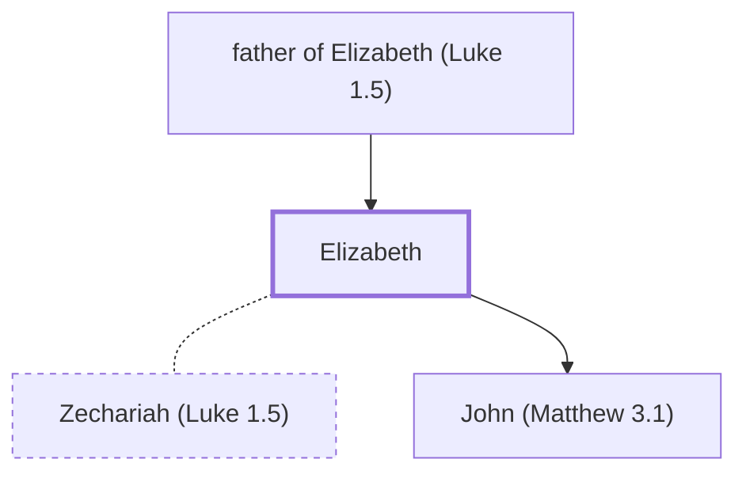

# Elizabeth

The wife of Zechariah and mother of John the Baptist.

**Original-language names:** Ἐλισάβετ (G1665)

## When

- **Placed around:** [[connections/timeline/1st century BC|5 BC]] *(Ussher: the median date of the passages naming them)*

## Family

- **Father:** [[connections/people/father of Elizabeth (Luke 1.5)|father of Elizabeth (Luke 1.5)]]
- **Spouses:** [[connections/people/Zechariah (Luke 1.5)|Zechariah (Luke 1.5)]]
- **Children:** [[connections/people/John (Matthew 3.1)|John (Matthew 3.1)]]
- **Tribe or nation:** Tribe of Levi

**Family group:** [[connections/genealogy/Family of Adam|Family of Adam]], generation 2

## Appears in

[[connections/chapters/42-luke/Luke 1|Luke 1 (8)]]

## Appears in the same verse as

[[connections/people/Zechariah (Luke 1.5)|Zechariah (Luke 1.5) (3)]] · [[connections/people/Aaron|Aaron]] · [[connections/people/Abijah (1 Chronicles 24.10)|Abijah (1 Chronicles 24.10)]] · [[connections/people/Herod (Matthew 2.1)|Herod (Matthew 2.1)]] · [[connections/people/John (Matthew 3.1)|John (Matthew 3.1)]] · [[connections/people/Mary (Matthew 1.16)|Mary (Matthew 1.16)]] · [[connections/places/Judea|Judea]]
