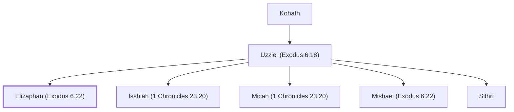

# Elizaphan (Exodus 6.22)

A Levite leader from the Kohathite clan.

**Also called:** Elzaphan

**Original-language names:** אֱלִיצָפָן (H0469) · עֻזִּיאֵל (H0469)

## When

- **Placed around:** [[connections/timeline/15th century BC|1490 BC]] *(Ussher: the median date of the passages naming them)*

## Family

- **Father:** [[connections/people/Uzziel (Exodus 6.18)|Uzziel (Exodus 6.18)]]
- **Brothers and sisters:** [[connections/people/Isshiah (1 Chronicles 23.20)|Isshiah (1 Chronicles 23.20)]], [[connections/people/Micah (1 Chronicles 23.20)|Micah (1 Chronicles 23.20)]], [[connections/people/Mishael (Exodus 6.22)|Mishael (Exodus 6.22)]], [[connections/people/Sithri|Sithri]]
- **Tribe or nation:** Tribe of Levi

**Line of descent** (27 generations, father to son): [[connections/people/Adam|Adam]] → [[connections/people/Seth|Seth]] → [[connections/people/Enosh|Enosh]] → [[connections/people/Kenan|Kenan]] → [[connections/people/Mahalalel (Genesis 5.12)|Mahalalel (Genesis 5.12)]] → [[connections/people/Jared|Jared]] → [[connections/people/Enoch (Genesis 5.18)|Enoch (Genesis 5.18)]] → [[connections/people/Methuselah|Methuselah]] → [[connections/people/Lamech (Genesis 5.25)|Lamech (Genesis 5.25)]] → [[connections/people/Noah (Genesis 5.29)|Noah (Genesis 5.29)]] → [[connections/people/Shem|Shem]] → [[connections/people/Arpachshad|Arpachshad]] → [[connections/people/Cainan|Cainan]] → [[connections/people/Shelah (Genesis 10.24)|Shelah (Genesis 10.24)]] → [[connections/people/Eber (Genesis 10.21)|Eber (Genesis 10.21)]] → [[connections/people/Peleg|Peleg]] → [[connections/people/Reu|Reu]] → [[connections/people/Serug|Serug]] → [[connections/people/Nahor (Genesis 11.22)|Nahor (Genesis 11.22)]] → [[connections/people/Terah|Terah]] → [[connections/people/Abraham|Abraham]] → [[connections/people/Isaac|Isaac]] → [[connections/people/Israel|Israel]] → [[connections/people/Levi (Genesis 29.34)|Levi (Genesis 29.34)]] → [[connections/people/Kohath|Kohath]] → [[connections/people/Uzziel (Exodus 6.18)|Uzziel (Exodus 6.18)]] → **Elizaphan (Exodus 6.22)**

**Family group:** [[connections/genealogy/Family of Adam|Family of Adam]], generation 27

## Appears in

[[connections/chapters/02-exodus/Exodus 6|Exodus 6]] · [[connections/chapters/03-leviticus/Leviticus 10|Leviticus 10]] · [[connections/chapters/04-numbers/Numbers 3|Numbers 3]] · [[connections/chapters/13-1-chronicles/1 Chronicles 15|1 Chronicles 15]] · [[connections/chapters/14-2-chronicles/2 Chronicles 29|2 Chronicles 29]]

## Appears in the same verse as

[[connections/people/Uzziel (Exodus 6.18)|Uzziel (Exodus 6.18) (3)]] · [[connections/people/Mishael (Exodus 6.22)|Mishael (Exodus 6.22) (2)]] · [[connections/people/Aaron|Aaron]] · [[connections/people/Asaph (1 Chronicles 6.24)|Asaph (1 Chronicles 6.24)]] · [[connections/people/Jeuel (2 Chronicles 29.13)|Jeuel (2 Chronicles 29.13)]] · [[connections/people/Mattaniah (2 Chronicles 29.13)|Mattaniah (2 Chronicles 29.13)]] · [[connections/people/Moses|Moses]] · [[connections/people/Shemaiah (1 Chronicles 15.8)|Shemaiah (1 Chronicles 15.8)]] · [[connections/people/Shimri (2 Chronicles 29.13)|Shimri (2 Chronicles 29.13)]] · [[connections/people/Sithri|Sithri]] · [[connections/people/Zechariah (2 Chronicles 29.13)|Zechariah (2 Chronicles 29.13)]]
