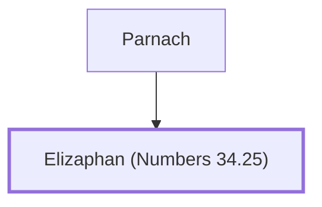

# Elizaphan (Numbers 34.25)

A leader from the tribe of Zebulun.

**Original-language names:** אֱלִיצָפָן (H0469)

## When

- **Placed around:** [[connections/timeline/15th century BC|1452 BC]] *(Ussher: the median date of the passages naming them)*

## Family

- **Father:** [[connections/people/Parnach|Parnach]]

**Family group:** [[connections/genealogy/Family of Parnach|Family of Parnach]], generation 2

## Appears in

[[connections/chapters/04-numbers/Numbers 34|Numbers 34]]

## Appears in the same verse as

[[connections/people/Parnach|Parnach]] · [[connections/people/Zebulun|Zebulun]]
