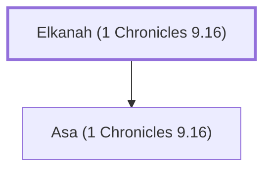

# Elkanah (1 Chronicles 9.16)

A Levite gatekeeper in Jerusalem.

**Original-language names:** אֶלְקָנָה (H0511)

## When

- **Placed around:** [[connections/timeline/6th century BC|536 BC]] *(Ussher: the median date of the passages naming them)*

## Family

- **Children:** [[connections/people/Asa (1 Chronicles 9.16)|Asa (1 Chronicles 9.16)]]
- **Tribe or nation:** Tribe of Levi

**Family group:** [[connections/genealogy/Family of Elkanah (1 Chronicles 9.16)|Family of Elkanah (1 Chronicles 9.16)]], generation 1

## Appears in

[[connections/chapters/13-1-chronicles/1 Chronicles 9|1 Chronicles 9]]

## Appears in the same verse as

[[connections/people/Asa (1 Chronicles 9.16)|Asa (1 Chronicles 9.16)]] · [[connections/people/Berechiah (1 Chronicles 9.16)|Berechiah (1 Chronicles 9.16)]] · [[connections/people/Galal (1 Chronicles 9.16)|Galal (1 Chronicles 9.16)]] · [[connections/people/Jeduthun (1 Chronicles 9.16)|Jeduthun (1 Chronicles 9.16)]] · [[connections/people/Obadiah (1 Chronicles 9.16)|Obadiah (1 Chronicles 9.16)]] · [[connections/people/Shemaiah (1 Chronicles 9.16)|Shemaiah (1 Chronicles 9.16)]]
