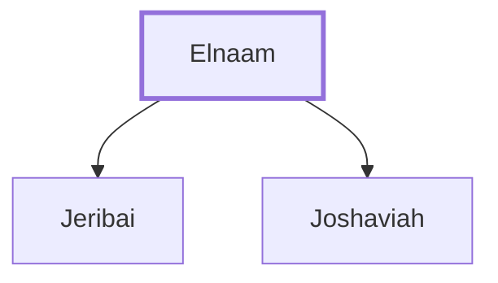

# Elnaam

Father of Jeribai and Joshaviah, David's mighty men.

**Original-language names:** אֶלְנָ֑עַם (H0493)

## When

- **Placed around:** [[connections/timeline/11th century BC|1055 BC]] *(Ussher: the median date of the passages naming them)*

## Family

- **Children:** [[connections/people/Jeribai|Jeribai]], [[connections/people/Joshaviah|Joshaviah]]

**Family group:** [[connections/genealogy/Family of Elnaam|Family of Elnaam]], generation 1

## Appears in

[[connections/chapters/13-1-chronicles/1 Chronicles 11|1 Chronicles 11]]

## Appears in the same verse as

[[connections/people/Eliel (1 Chronicles 11.46)|Eliel (1 Chronicles 11.46)]] · [[connections/people/Ithmah|Ithmah]] · [[connections/people/Jeribai|Jeribai]] · [[connections/people/Joshaviah|Joshaviah]] · [[connections/places/Moab|Moab]]
