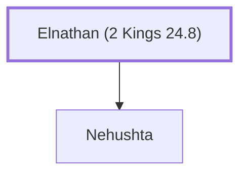

# Elnathan (2 Kings 24.8)

Father of Nehushta, King Jehoiachin's mother.

**Original-language names:** אֶלְנָתָן (H0494)

## When

- **Placed around:** [[connections/timeline/6th century BC|599 BC]] *(Ussher: the median date of the passages naming them)*

## Family

- **Children:** [[connections/people/Nehushta|Nehushta]]

**Family group:** [[connections/genealogy/Family of Adam|Family of Adam]], generation 1

## Appears in

[[connections/chapters/12-2-kings/2 Kings 24|2 Kings 24]]

## Appears in the same verse as

[[connections/people/Jehoiachin|Jehoiachin]] · [[connections/people/Nehushta|Nehushta]] · [[connections/places/Jerusalem|Jerusalem]]
