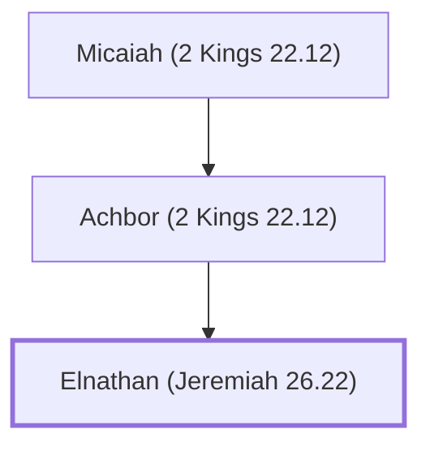

# Elnathan (Jeremiah 26.22)

A royal official during the reign of King Jehoiakim.

**Original-language names:** אֶלְנָתָן (H0494)

## When

- **Placed around:** [[connections/timeline/7th century BC|606 BC]] *(Ussher: the median date of the passages naming them)*

## Family

- **Father:** [[connections/people/Achbor (2 Kings 22.12)|Achbor (2 Kings 22.12)]]

**Line of descent** (3 generations, father to son): [[connections/people/Micaiah (2 Kings 22.12)|Micaiah (2 Kings 22.12)]] → [[connections/people/Achbor (2 Kings 22.12)|Achbor (2 Kings 22.12)]] → **Elnathan (Jeremiah 26.22)**

**Family group:** [[connections/genealogy/Family of Micaiah (2 Kings 22.12)|Family of Micaiah (2 Kings 22.12)]], generation 3

## Appears in

[[connections/chapters/24-jeremiah/Jeremiah 26|Jeremiah 26]] · [[connections/chapters/24-jeremiah/Jeremiah 36|Jeremiah 36 (2)]]

## Appears in the same verse as

[[connections/people/Achbor (2 Kings 22.12)|Achbor (2 Kings 22.12) (2)]] · [[connections/people/Delaiah (Jeremiah 36.12)|Delaiah (Jeremiah 36.12) (2)]] · [[connections/people/Gemariah (Jeremiah 36.10)|Gemariah (Jeremiah 36.10) (2)]] · [[connections/people/Elishama (Jeremiah 36.12)|Elishama (Jeremiah 36.12)]] · [[connections/people/Hananiah (Jeremiah 36.12)|Hananiah (Jeremiah 36.12)]] · [[connections/people/Jehoiakim|Jehoiakim]] · [[connections/people/Shaphan (2 Kings 22.3)|Shaphan (2 Kings 22.3)]] · [[connections/people/Shemaiah (Jeremiah 36.12)|Shemaiah (Jeremiah 36.12)]] · [[connections/people/Zedekiah (Jeremiah 36.12)|Zedekiah (Jeremiah 36.12)]] · [[connections/places/Egypt|Egypt]]
