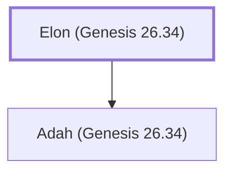

# Elon (Genesis 26.34)

A Hittite, father-in-law of Esau.

**Original-language names:** אֵלוֹן (H0356)

## When

- **Placed around:** [[connections/timeline/18th century BC|1796 BC]] *(Ussher: the median date of the passages naming them)*

## Family

- **Children:** [[connections/people/Adah (Genesis 26.34)|Adah (Genesis 26.34)]]
- **Tribe or nation:** Edom

**Family group:** [[connections/genealogy/Family of Adam|Family of Adam]], generation 1

## Appears in

[[connections/chapters/01-genesis/Genesis 26|Genesis 26]] · [[connections/chapters/01-genesis/Genesis 36|Genesis 36]]

## Appears in the same verse as

[[connections/people/Adah (Genesis 26.34)|Adah (Genesis 26.34) (2)]] · [[connections/people/Esau|Esau (2)]] · [[connections/people/Anah|Anah]] · [[connections/people/Beeri (Genesis 26.34)|Beeri (Genesis 26.34)]] · [[connections/people/Judith|Judith]] · [[connections/people/Oholibamah|Oholibamah]] · [[connections/people/Zibeon|Zibeon]] · [[connections/places/Canaan|Canaan]]
