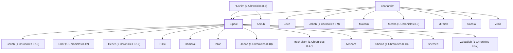

# Elpaal

A Benjamite, son of Shaharaim.

**Original-language names:** אֶלְפַּ֫עַל (H0508)

## Family

- **Father:** [[connections/people/Shaharaim|Shaharaim]]
- **Mother:** [[connections/people/Hushim (1 Chronicles 8.8)|Hushim (1 Chronicles 8.8)]]
- **Brothers and sisters:** [[connections/people/Abitub|Abitub]], [[connections/people/Jeuz|Jeuz]], [[connections/people/Jobab (1 Chronicles 8.9)|Jobab (1 Chronicles 8.9)]], [[connections/people/Malcam|Malcam]], [[connections/people/Mesha (1 Chronicles 8.9)|Mesha (1 Chronicles 8.9)]], [[connections/people/Mirmah|Mirmah]], [[connections/people/Sachia|Sachia]], [[connections/people/Zibia|Zibia]]
- **Children:** [[connections/people/Beriah (1 Chronicles 8.13)|Beriah (1 Chronicles 8.13)]], [[connections/people/Eber (1 Chronicles 8.12)|Eber (1 Chronicles 8.12)]], [[connections/people/Heber (1 Chronicles 8.17)|Heber (1 Chronicles 8.17)]], [[connections/people/Hizki|Hizki]], [[connections/people/Ishmerai|Ishmerai]], [[connections/people/Izliah|Izliah]], [[connections/people/Jobab (1 Chronicles 8.18)|Jobab (1 Chronicles 8.18)]], [[connections/people/Meshullam (1 Chronicles 8.17)|Meshullam (1 Chronicles 8.17)]], [[connections/people/Misham|Misham]], [[connections/people/Shema (1 Chronicles 8.13)|Shema (1 Chronicles 8.13)]], [[connections/people/Shemed|Shemed]], [[connections/people/Zebadiah (1 Chronicles 8.17)|Zebadiah (1 Chronicles 8.17)]]
- **Tribe or nation:** Tribe of Benjamin

**Family group:** [[connections/genealogy/Family of Shaharaim|Family of Shaharaim]], generation 2

## Appears in

[[connections/chapters/13-1-chronicles/1 Chronicles 8|1 Chronicles 8 (3)]]

## Appears in the same verse as

[[connections/people/Abitub|Abitub]] · [[connections/people/Eber (1 Chronicles 8.12)|Eber (1 Chronicles 8.12)]] · [[connections/people/Hushim (1 Chronicles 8.8)|Hushim (1 Chronicles 8.8)]] · [[connections/people/Ishmerai|Ishmerai]] · [[connections/people/Izliah|Izliah]] · [[connections/people/Jobab (1 Chronicles 8.18)|Jobab (1 Chronicles 8.18)]] · [[connections/people/Misham|Misham]] · [[connections/people/Shemed|Shemed]] · [[connections/places/Lod|Lod]] · [[connections/places/Ono|Ono]]
