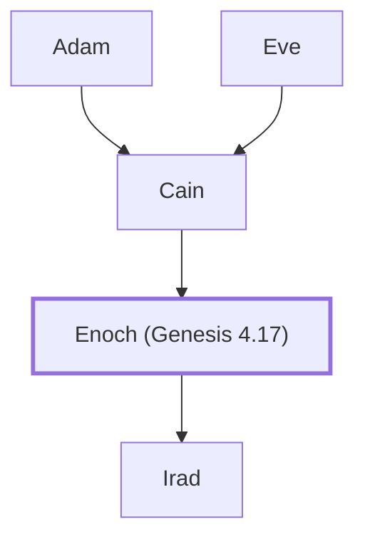

# Enoch (Genesis 4.17)

Son of Cain, and a city named after him.

**Original-language names:** חֲנוֹךְ (H2585)

## When

- **Placed around:** [[connections/timeline/41st century BC|4003 BC]] *(Ussher: the median date of the passages naming them)*

## Family

- **Father:** [[connections/people/Cain|Cain]]
- **Children:** [[connections/people/Irad|Irad]]
- **Tribe or nation:** Early Patriarch

**Line of descent** (3 generations, father to son): [[connections/people/Adam|Adam]] → [[connections/people/Cain|Cain]] → **Enoch (Genesis 4.17)**

**Family group:** [[connections/genealogy/Family of Adam|Family of Adam]], generation 3

## Appears in

[[connections/chapters/01-genesis/Genesis 4|Genesis 4 (2)]]

## Appears in the same verse as

[[connections/people/Cain|Cain]] · [[connections/people/Irad|Irad]] · [[connections/people/Lamech (Genesis 4.18)|Lamech (Genesis 4.18)]] · [[connections/people/Mehujael|Mehujael]] · [[connections/people/Methushael|Methushael]]
