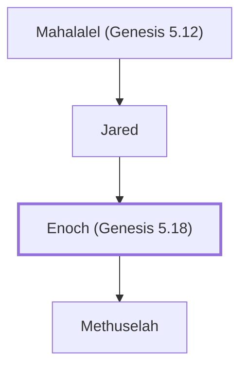

# Enoch (Genesis 5.18)

A righteous man who walked with God.

**Original-language names:** חֲנוֹךְ (H2585) · Ἐνώχ (G1802)

## When

- **Lived:** [[connections/timeline/34th century BC|3382 BC]] – [[connections/timeline/31st century BC|3017 BC]] *(Jones)*
- **Placed around:** [[connections/timeline/31st century BC|3017 BC]] *(Ussher: the median date of the passages naming them)*

## Family

- **Father:** [[connections/people/Jared|Jared]]
- **Children:** [[connections/people/Methuselah|Methuselah]]
- **Tribe or nation:** Early Patriarch

**Line of descent** (7 generations, father to son): [[connections/people/Adam|Adam]] → [[connections/people/Seth|Seth]] → [[connections/people/Enosh|Enosh]] → [[connections/people/Kenan|Kenan]] → [[connections/people/Mahalalel (Genesis 5.12)|Mahalalel (Genesis 5.12)]] → [[connections/people/Jared|Jared]] → **Enoch (Genesis 5.18)**

**Family group:** [[connections/genealogy/Family of Adam|Family of Adam]], generation 7

## Events

- [[connections/timeline/34th century BC|3382 BC]] · [[connections/events/Birth of Enoch|Birth of Enoch]]
- [[connections/timeline/34th century BC|3382 BC]] · [[connections/events/Lifetime of Enoch|Lifetime of Enoch]]
- [[connections/timeline/34th century BC|3317 BC]] · [[connections/events/Birth of Methuselah|Birth of Methuselah]]
- [[connections/timeline/31st century BC|3017 BC]] · [[connections/events/Enoch taken up|Enoch taken up]]

## Appears in

[[connections/chapters/01-genesis/Genesis 5|Genesis 5 (6)]] · [[connections/chapters/13-1-chronicles/1 Chronicles 1|1 Chronicles 1]] · [[connections/chapters/42-luke/Luke 3|Luke 3]] · [[connections/chapters/58-hebrews/Hebrews 11|Hebrews 11]] · [[connections/chapters/65-jude/Jude 1|Jude 1]]

## Appears in the same verse as

[[connections/people/Methuselah|Methuselah (4)]] · [[connections/people/Jared|Jared (3)]] · [[connections/people/Adam|Adam]] · [[connections/people/Kenan|Kenan]] · [[connections/people/Lamech (Genesis 5.25)|Lamech (Genesis 5.25)]] · [[connections/people/Mahalalel (Genesis 5.12)|Mahalalel (Genesis 5.12)]]
