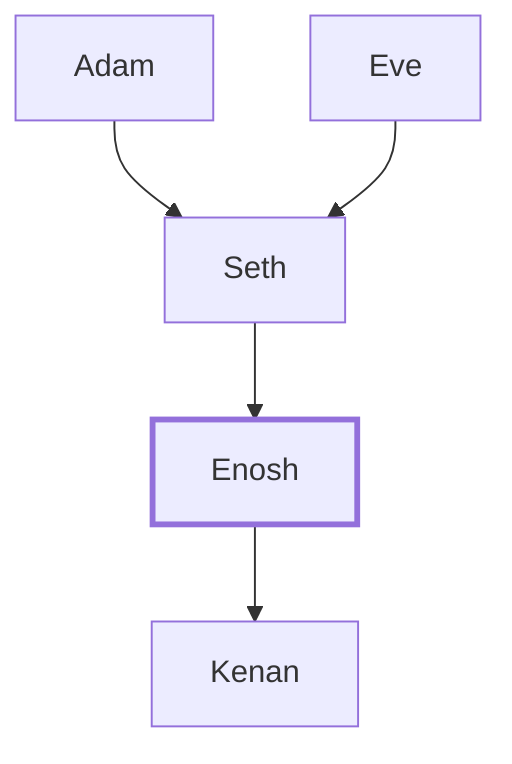

# Enosh

Son of Seth, during whose time people called on the Lord's name.

**Also called:** Enos

**Original-language names:** אֱנוֹשׁ (H0583) · Ἐνώς (G1800)

## When

- **Lived:** [[connections/timeline/38th century BC|3769 BC]] – [[connections/timeline/29th century BC|2864 BC]] *(Jones)*
- **Placed around:** [[connections/timeline/37th century BC|3679 BC]] *(Ussher: the median date of the passages naming them)*

## Family

- **Father:** [[connections/people/Seth|Seth]]
- **Children:** [[connections/people/Kenan|Kenan]]
- **Tribe or nation:** Early Patriarch

**Line of descent** (3 generations, father to son): [[connections/people/Adam|Adam]] → [[connections/people/Seth|Seth]] → **Enosh**

**Family group:** [[connections/genealogy/Family of Adam|Family of Adam]], generation 3

## Events

- [[connections/timeline/38th century BC|3769 BC]] · [[connections/events/Birth of Enos|Birth of Enos]]
- [[connections/timeline/38th century BC|3769 BC]] · [[connections/events/Lifetime of Enos|Lifetime of Enos]]
- [[connections/timeline/37th century BC|3679 BC]] · [[connections/events/Birth of Cainan|Birth of Cainan]]
- [[connections/timeline/29th century BC|2864 BC]] · [[connections/events/Death of Enos|Death of Enos]]

## Appears in

[[connections/chapters/01-genesis/Genesis 4|Genesis 4]] · [[connections/chapters/01-genesis/Genesis 5|Genesis 5 (5)]] · [[connections/chapters/13-1-chronicles/1 Chronicles 1|1 Chronicles 1]] · [[connections/chapters/42-luke/Luke 3|Luke 3]]

## Appears in the same verse as

[[connections/people/Seth|Seth (5)]] · [[connections/people/Adam|Adam (2)]] · [[connections/people/Kenan|Kenan (2)]]
