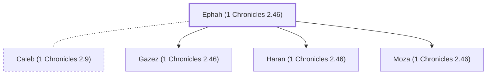

# Ephah (1 Chronicles 2.46)

Caleb's concubine and mother of three sons.

**Original-language names:** עֵיפָה (H5891)

## When

- **Placed around:** [[connections/timeline/15th century BC|1470 BC]] *(Ussher: the median date of the passages naming them)*

## Family

- **Spouses:** [[connections/people/Caleb (1 Chronicles 2.9)|Caleb (1 Chronicles 2.9)]]
- **Children:** [[connections/people/Gazez (1 Chronicles 2.46)|Gazez (1 Chronicles 2.46)]], [[connections/people/Haran (1 Chronicles 2.46)|Haran (1 Chronicles 2.46)]], [[connections/people/Moza (1 Chronicles 2.46)|Moza (1 Chronicles 2.46)]]
- **Tribe or nation:** Tribe of Judah(?)

**Family group:** [[connections/genealogy/Family of Adam|Family of Adam]], generation 29

## Appears in

[[connections/chapters/13-1-chronicles/1 Chronicles 2|1 Chronicles 2]]

## Appears in the same verse as

[[connections/people/Caleb (1 Chronicles 2.9)|Caleb (1 Chronicles 2.9)]] · [[connections/people/Gazez (1 Chronicles 2.46)|Gazez (1 Chronicles 2.46)]] · [[connections/people/Gazez (1 Chronicles 2.46)|Gazez (1 Chronicles 2.46)]] · [[connections/people/Haran (1 Chronicles 2.46)|Haran (1 Chronicles 2.46)]] · [[connections/people/Moza (1 Chronicles 2.46)|Moza (1 Chronicles 2.46)]]
