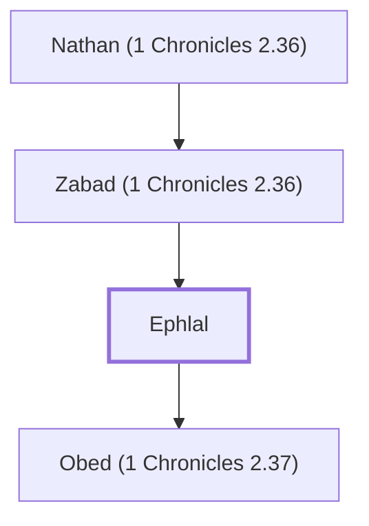

# Ephlal

Son of Zabad, in the genealogy of Judah.

**Original-language names:** אֶפְלָל (H0654)

## When

- **Placed around:** [[connections/timeline/15th century BC|1470 BC]] *(Ussher: the median date of the passages naming them)*

## Family

- **Father:** [[connections/people/Zabad (1 Chronicles 2.36)|Zabad (1 Chronicles 2.36)]]
- **Children:** [[connections/people/Obed (1 Chronicles 2.37)|Obed (1 Chronicles 2.37)]]
- **Tribe or nation:** Tribe of Judah

**Line of descent** (5 generations, father to son): [[connections/people/Jarha|Jarha]] → [[connections/people/Attai (1 Chronicles 2.35)|Attai (1 Chronicles 2.35)]] → [[connections/people/Nathan (1 Chronicles 2.36)|Nathan (1 Chronicles 2.36)]] → [[connections/people/Zabad (1 Chronicles 2.36)|Zabad (1 Chronicles 2.36)]] → **Ephlal**

**Family group:** [[connections/genealogy/Family of Ishi (1 Chronicles 2.31)|Family of Ishi (1 Chronicles 2.31)]], generation 7

## Appears in

[[connections/chapters/13-1-chronicles/1 Chronicles 2|1 Chronicles 2]]

## Appears in the same verse as

[[connections/people/Obed (1 Chronicles 2.37)|Obed (1 Chronicles 2.37)]] · [[connections/people/Zabad (1 Chronicles 2.36)|Zabad (1 Chronicles 2.36)]]
