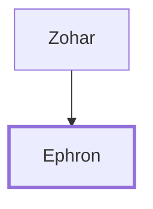

# Ephron

A Hittite who sold a burial site to Abraham.

**Original-language names:** עֶפְרוֹן (H6085)

## When

- **Placed around:** [[connections/timeline/19th century BC|1860 BC]] *(Ussher: the median date of the passages naming them)*

## Family

- **Father:** [[connections/people/Zohar|Zohar]]

**Family group:** [[connections/genealogy/Family of Zohar|Family of Zohar]], generation 2

## Appears in

[[connections/chapters/01-genesis/Genesis 23|Genesis 23 (6)]] · [[connections/chapters/01-genesis/Genesis 25|Genesis 25]] · [[connections/chapters/01-genesis/Genesis 49|Genesis 49 (2)]] · [[connections/chapters/01-genesis/Genesis 50|Genesis 50]]

## Appears in the same verse as

[[connections/people/Abraham|Abraham (5)]] · [[connections/places/Machpelah|Machpelah (4)]] · [[connections/places/Mamre|Mamre (4)]] · [[connections/people/Heth|Heth (2)]] · [[connections/people/Zohar|Zohar (2)]] · [[connections/places/Canaan|Canaan (2)]] · [[connections/people/Isaac|Isaac]] · [[connections/people/Ishmael (Genesis 16.11)|Ishmael (Genesis 16.11)]]
