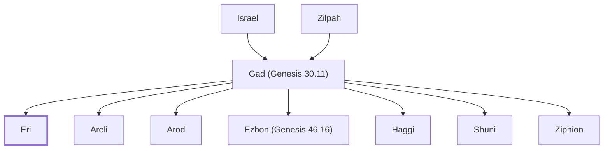

# Eri

Son of Gad; head of the Erite clan.

**Original-language names:** עֵרִי (H6179)

## When

- **Placed around:** [[connections/timeline/15th century BC|1452 BC]] *(Ussher: the median date of the passages naming them)*

## Family

- **Father:** [[connections/people/Gad (Genesis 30.11)|Gad (Genesis 30.11)]]
- **Brothers and sisters:** [[connections/people/Areli|Areli]], [[connections/people/Arod|Arod]], [[connections/people/Ezbon (Genesis 46.16)|Ezbon (Genesis 46.16)]], [[connections/people/Haggi|Haggi]], [[connections/people/Shuni|Shuni]], [[connections/people/Ziphion|Ziphion]]
- **Tribe or nation:** Tribe of Gad

**Line of descent** (25 generations, father to son): [[connections/people/Adam|Adam]] → [[connections/people/Seth|Seth]] → [[connections/people/Enosh|Enosh]] → [[connections/people/Kenan|Kenan]] → [[connections/people/Mahalalel (Genesis 5.12)|Mahalalel (Genesis 5.12)]] → [[connections/people/Jared|Jared]] → [[connections/people/Enoch (Genesis 5.18)|Enoch (Genesis 5.18)]] → [[connections/people/Methuselah|Methuselah]] → [[connections/people/Lamech (Genesis 5.25)|Lamech (Genesis 5.25)]] → [[connections/people/Noah (Genesis 5.29)|Noah (Genesis 5.29)]] → [[connections/people/Shem|Shem]] → [[connections/people/Arpachshad|Arpachshad]] → [[connections/people/Cainan|Cainan]] → [[connections/people/Shelah (Genesis 10.24)|Shelah (Genesis 10.24)]] → [[connections/people/Eber (Genesis 10.21)|Eber (Genesis 10.21)]] → [[connections/people/Peleg|Peleg]] → [[connections/people/Reu|Reu]] → [[connections/people/Serug|Serug]] → [[connections/people/Nahor (Genesis 11.22)|Nahor (Genesis 11.22)]] → [[connections/people/Terah|Terah]] → [[connections/people/Abraham|Abraham]] → [[connections/people/Isaac|Isaac]] → [[connections/people/Israel|Israel]] → [[connections/people/Gad (Genesis 30.11)|Gad (Genesis 30.11)]] → **Eri**

**Family group:** [[connections/genealogy/Family of Adam|Family of Adam]], generation 25

## Appears in

[[connections/chapters/01-genesis/Genesis 46|Genesis 46]] · [[connections/chapters/04-numbers/Numbers 26|Numbers 26]]

## Appears in the same verse as

[[connections/people/Ezbon (Genesis 46.16)|Ezbon (Genesis 46.16) (2)]] · [[connections/people/Areli|Areli]] · [[connections/people/Arod|Arod]] · [[connections/people/Gad (Genesis 30.11)|Gad (Genesis 30.11)]] · [[connections/people/Haggi|Haggi]] · [[connections/people/Shuni|Shuni]] · [[connections/people/Ziphion|Ziphion]]
