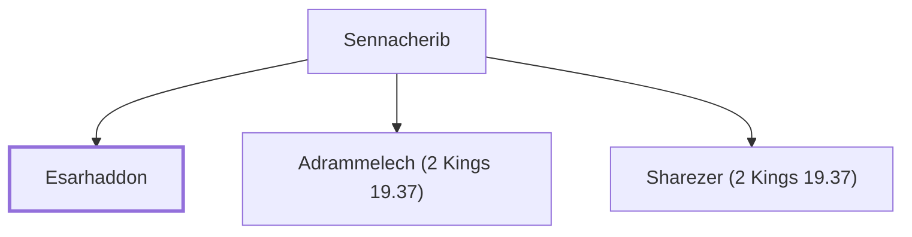

# Esarhaddon

King of Assyria; son and successor of Sennacherib.

**Original-language names:** אֵסַר־חַדּוֹן (H0634)

## When

- **Placed around:** [[connections/timeline/8th century BC|710 BC]] *(Ussher: the median date of the passages naming them)*
- **Reigned / in office:** [[connections/timeline/7th century BC|681 BC]] – [[connections/timeline/7th century BC|669 BC]] *(modern dates)* · Esarhaddon, Assyria

## Family

- **Father:** [[connections/people/Sennacherib|Sennacherib]]
- **Brothers and sisters:** [[connections/people/Adrammelech (2 Kings 19.37)|Adrammelech (2 Kings 19.37)]], [[connections/people/Sharezer (2 Kings 19.37)|Sharezer (2 Kings 19.37)]]
- **Tribe or nation:** Assyria

**Family group:** [[connections/genealogy/Family of Sennacherib|Family of Sennacherib]], generation 2

## Appears in

[[connections/chapters/12-2-kings/2 Kings 19|2 Kings 19]] · [[connections/chapters/15-ezra/Ezra 4|Ezra 4]] · [[connections/chapters/23-isaiah/Isaiah 37|Isaiah 37]]

## Appears in the same verse as

[[connections/people/Adrammelech (2 Kings 19.37)|Adrammelech (2 Kings 19.37) (2)]] · [[connections/people/Sharezer (2 Kings 19.37)|Sharezer (2 Kings 19.37) (2)]] · [[connections/places/Ararat|Ararat (2)]] · [[connections/people/Zerubbabel (1 Chronicles 3.19)|Zerubbabel (1 Chronicles 3.19)]] · [[connections/places/Assyria|Assyria]]
