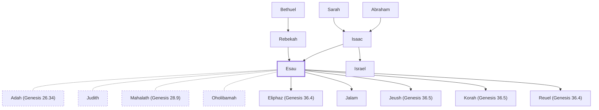

# Esau

Isaac's firstborn son; sold birthright to Jacob; became Edom.

**Also called:** Edom

**Original-language names:** עֵשָׂו (H6215) · Ἠσαῦ (G2269) · אֱדוֹם (H0123)

## When

- **Lived:** [[connections/timeline/19th century BC|1836 BC]] – ? *(Jones)*
- **Placed around:** [[connections/timeline/18th century BC|1760 BC]] *(Ussher: the median date of the passages naming them)*

## Family

- **Father:** [[connections/people/Isaac|Isaac]]
- **Mother:** [[connections/people/Rebekah|Rebekah]]
- **Brothers and sisters:** [[connections/people/Israel|Israel]]
- **Spouses:** [[connections/people/Adah (Genesis 26.34)|Adah (Genesis 26.34)]], [[connections/people/Judith|Judith]], [[connections/people/Mahalath (Genesis 28.9)|Mahalath (Genesis 28.9)]], [[connections/people/Oholibamah|Oholibamah]]
- **Children:** [[connections/people/Eliphaz (Genesis 36.4)|Eliphaz (Genesis 36.4)]], [[connections/people/Jalam|Jalam]], [[connections/people/Jeush (Genesis 36.5)|Jeush (Genesis 36.5)]], [[connections/people/Korah (Genesis 36.5)|Korah (Genesis 36.5)]], [[connections/people/Reuel (Genesis 36.4)|Reuel (Genesis 36.4)]]
- **Tribe or nation:** Edom

**Line of descent** (23 generations, father to son): [[connections/people/Adam|Adam]] → [[connections/people/Seth|Seth]] → [[connections/people/Enosh|Enosh]] → [[connections/people/Kenan|Kenan]] → [[connections/people/Mahalalel (Genesis 5.12)|Mahalalel (Genesis 5.12)]] → [[connections/people/Jared|Jared]] → [[connections/people/Enoch (Genesis 5.18)|Enoch (Genesis 5.18)]] → [[connections/people/Methuselah|Methuselah]] → [[connections/people/Lamech (Genesis 5.25)|Lamech (Genesis 5.25)]] → [[connections/people/Noah (Genesis 5.29)|Noah (Genesis 5.29)]] → [[connections/people/Shem|Shem]] → [[connections/people/Arpachshad|Arpachshad]] → [[connections/people/Cainan|Cainan]] → [[connections/people/Shelah (Genesis 10.24)|Shelah (Genesis 10.24)]] → [[connections/people/Eber (Genesis 10.21)|Eber (Genesis 10.21)]] → [[connections/people/Peleg|Peleg]] → [[connections/people/Reu|Reu]] → [[connections/people/Serug|Serug]] → [[connections/people/Nahor (Genesis 11.22)|Nahor (Genesis 11.22)]] → [[connections/people/Terah|Terah]] → [[connections/people/Abraham|Abraham]] → [[connections/people/Isaac|Isaac]] → **Esau**

**Family group:** [[connections/genealogy/Family of Adam|Family of Adam]], generation 23

## Events

- [[connections/timeline/19th century BC|1836 BC]] · [[connections/events/Birth of Jacob and Esau|Birth of Jacob and Esau]]

## Appears in

[[connections/chapters/01-genesis/Genesis 25|Genesis 25 (8)]] · [[connections/chapters/01-genesis/Genesis 26|Genesis 26]] · [[connections/chapters/01-genesis/Genesis 27|Genesis 27 (17)]] · [[connections/chapters/01-genesis/Genesis 28|Genesis 28 (4)]] · [[connections/chapters/01-genesis/Genesis 32|Genesis 32 (9)]] · [[connections/chapters/01-genesis/Genesis 33|Genesis 33 (5)]] · [[connections/chapters/01-genesis/Genesis 35|Genesis 35 (2)]] · [[connections/chapters/01-genesis/Genesis 36|Genesis 36 (16)]] · [[connections/chapters/06-joshua/Joshua 24|Joshua 24]] · [[connections/chapters/13-1-chronicles/1 Chronicles 1|1 Chronicles 1 (4)]] · [[connections/chapters/45-romans/Romans 9|Romans 9]] · [[connections/chapters/58-hebrews/Hebrews 11|Hebrews 11]] · [[connections/chapters/58-hebrews/Hebrews 12|Hebrews 12]]

## Appears in the same verse as

[[connections/people/Israel|Israel (29)]] · [[connections/people/Isaac|Isaac (16)]] · [[connections/people/Rebekah|Rebekah (7)]] · [[connections/people/Adah (Genesis 26.34)|Adah (Genesis 26.34) (5)]] · [[connections/people/Eliphaz (Genesis 36.4)|Eliphaz (Genesis 36.4) (5)]] · [[connections/people/Mahalath (Genesis 28.9)|Mahalath (Genesis 28.9) (5)]] · [[connections/people/Reuel (Genesis 36.4)|Reuel (Genesis 36.4) (5)]] · [[connections/places/Canaan|Canaan (5)]] · [[connections/places/Seir|Seir (5)]] · [[connections/people/Jalam|Jalam (4)]] · [[connections/people/Jeush (Genesis 36.5)|Jeush (Genesis 36.5) (4)]] · [[connections/people/Korah (Genesis 36.5)|Korah (Genesis 36.5) (4)]] · [[connections/people/Oholibamah|Oholibamah (4)]] · [[connections/people/Anah|Anah (3)]] · [[connections/places/Edom|Edom (3)]] · [[connections/people/Abraham|Abraham (2)]] · [[connections/people/Elon (Genesis 26.34)|Elon (Genesis 26.34) (2)]] · [[connections/people/Laban|Laban (2)]] · [[connections/people/Mizzah|Mizzah (2)]] · [[connections/people/Nahath (Genesis 36.13)|Nahath (Genesis 36.13) (2)]] · [[connections/people/Shammah (Genesis 36.13)|Shammah (Genesis 36.13) (2)]] · [[connections/people/Timna|Timna (2)]] · [[connections/people/Zerah (Genesis 36.13)|Zerah (Genesis 36.13) (2)]] · [[connections/people/Zibeon|Zibeon (2)]] · [[connections/places/Paddan|Paddan (2)]] · [[connections/people/Alvah|Alvah]] · [[connections/people/Amalek|Amalek]] · [[connections/people/Beeri (Genesis 26.34)|Beeri (Genesis 26.34)]] · [[connections/people/Bethuel|Bethuel]] · [[connections/people/Dishan|Dishan]] · [[connections/people/Dishon (Genesis 36.21)|Dishon (Genesis 36.21)]] · [[connections/people/Ezer (Genesis 36.21)|Ezer (Genesis 36.21)]] · [[connections/people/Hadad (Genesis 36.39)|Hadad (Genesis 36.39)]] · [[connections/people/Iram|Iram]] · [[connections/people/Ishmael (Genesis 16.11)|Ishmael (Genesis 16.11)]] · [[connections/people/Jetheth|Jetheth]] · [[connections/people/Judith|Judith]] · [[connections/people/Kenaz (Genesis 36.11)|Kenaz (Genesis 36.11)]] · [[connections/people/Leah|Leah]] · [[connections/people/Magdiel|Magdiel]] · [[connections/people/Nebaioth|Nebaioth]] · [[connections/people/Omar|Omar]] · [[connections/people/Rachel|Rachel]] · [[connections/people/Seir|Seir]] · [[connections/people/Teman|Teman]] · [[connections/people/Zepho|Zepho]] · [[connections/places/Bethel (Genesis 12.8)|Bethel (Genesis 12.8)]] · [[connections/places/Egypt|Egypt]]
