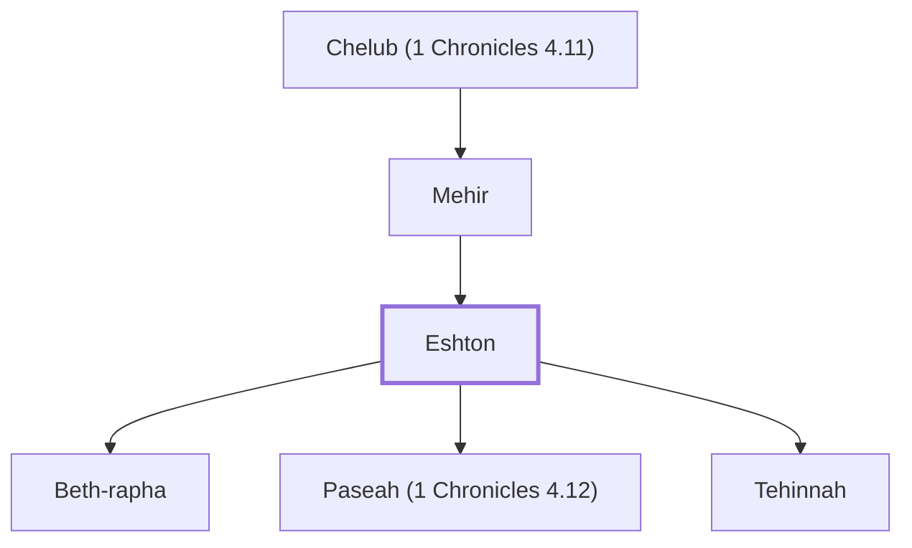

# Eshton

Son of Mehir; father of Beth-rapha, Paseah, and Tehinnah.

**Original-language names:** אֶשְׁתּוֹן (H0850)

## When

- **Placed around:** [[connections/timeline/18th century BC|1721 BC]] *(Ussher: the median date of the passages naming them)*

## Family

- **Father:** [[connections/people/Mehir|Mehir]]
- **Children:** [[connections/people/Beth-rapha|Beth-rapha]], [[connections/people/Paseah (1 Chronicles 4.12)|Paseah (1 Chronicles 4.12)]], [[connections/people/Tehinnah|Tehinnah]]
- **Tribe or nation:** Tribe of Judah

**Line of descent** (3 generations, father to son): [[connections/people/Chelub (1 Chronicles 4.11)|Chelub (1 Chronicles 4.11)]] → [[connections/people/Mehir|Mehir]] → **Eshton**

**Family group:** [[connections/genealogy/Family of Chelub (1 Chronicles 4.11)|Family of Chelub (1 Chronicles 4.11)]], generation 3

## Appears in

[[connections/chapters/13-1-chronicles/1 Chronicles 4|1 Chronicles 4 (2)]]

## Appears in the same verse as

[[connections/people/Beth-rapha|Beth-rapha]] · [[connections/people/Chelub (1 Chronicles 4.11)|Chelub (1 Chronicles 4.11)]] · [[connections/people/Mehir|Mehir]] · [[connections/people/Paseah (1 Chronicles 4.12)|Paseah (1 Chronicles 4.12)]] · [[connections/people/Shuhah|Shuhah]] · [[connections/people/Tehinnah|Tehinnah]] · [[connections/places/Ir-nahash|Ir-nahash]] · [[connections/places/Recah|Recah]]
