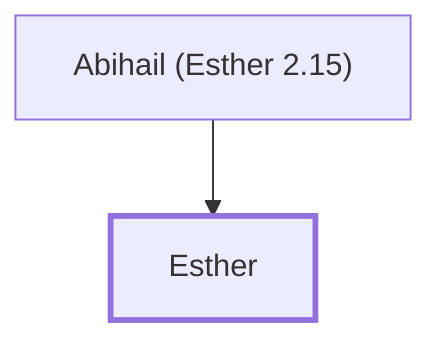

# Esther

Jewish queen of Persia; saved her people from genocide.

**Also called:** Hadassah

**Original-language names:** אֶסְתֵּר (H0635) · הֲדַסָּה (H1919)

## When

- **Placed around:** [[connections/timeline/5th century BC|453 BC]] *(Ussher: the median date of the passages naming them)*

## Family

- **Father:** [[connections/people/Abihail (Esther 2.15)|Abihail (Esther 2.15)]]

**Family group:** [[connections/genealogy/Family of Abihail (Esther 2.15)|Family of Abihail (Esther 2.15)]], generation 2

## Appears in

[[connections/chapters/17-esther/Esther 2|Esther 2 (10)]] · [[connections/chapters/17-esther/Esther 4|Esther 4 (9)]] · [[connections/chapters/17-esther/Esther 5|Esther 5 (8)]] · [[connections/chapters/17-esther/Esther 6|Esther 6]] · [[connections/chapters/17-esther/Esther 7|Esther 7 (7)]] · [[connections/chapters/17-esther/Esther 8|Esther 8 (5)]] · [[connections/chapters/17-esther/Esther 9|Esther 9 (5)]]

## Appears in the same verse as

[[connections/people/Mordecai (Esther 2.5)|Mordecai (Esther 2.5) (19)]] · [[connections/people/Haman|Haman (14)]] · [[connections/people/Ahasuerus|Ahasuerus (4)]] · [[connections/places/Susa|Susa (4)]] · [[connections/people/Hathach|Hathach (3)]] · [[connections/people/Abihail (Esther 2.15)|Abihail (Esther 2.15) (2)]] · [[connections/people/Hegai|Hegai (2)]] · [[connections/people/Vashti|Vashti]]
