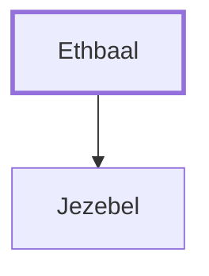

# Ethbaal

King of Sidon; father of Jezebel.

**Original-language names:** אֶתְבַּ֫עַל (H0856)

## When

- **Placed around:** [[connections/timeline/10th century BC|918 BC]] *(Ussher: the median date of the passages naming them)*

## Family

- **Children:** [[connections/people/Jezebel|Jezebel]]
- **Tribe or nation:** Syria

**Family group:** [[connections/genealogy/Family of Adam|Family of Adam]], generation 1

## Appears in

[[connections/chapters/11-1-kings/1 Kings 16|1 Kings 16]]

## Appears in the same verse as

[[connections/people/Jeroboam (1 Kings 11.26)|Jeroboam (1 Kings 11.26)]] · [[connections/people/Jezebel|Jezebel]] · [[connections/people/Nebat|Nebat]]
