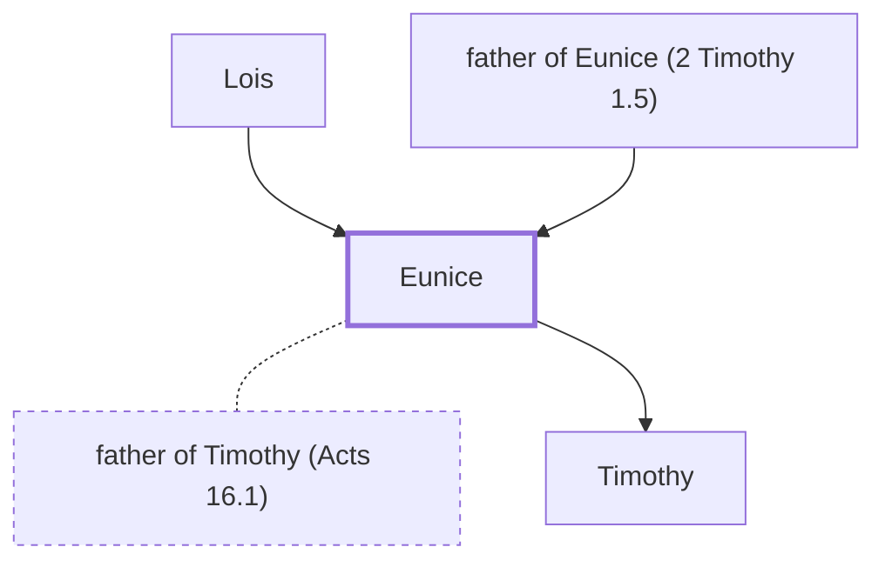

# Eunice

Mother of Timothy; a Jewish believer.

**Original-language names:** Εὐνίκη (G2131)

## When

- **Placed around:** [[connections/timeline/1st century AD|AD 66]] *(Ussher: the median date of the passages naming them)*

## Family

- **Father:** [[connections/people/father of Eunice (2 Timothy 1.5)|father of Eunice (2 Timothy 1.5)]]
- **Mother:** [[connections/people/Lois|Lois]]
- **Spouses:** [[connections/people/father of Timothy (Acts 16.1)|father of Timothy (Acts 16.1)]]
- **Children:** [[connections/people/Timothy|Timothy]]

**Family group:** [[connections/genealogy/Family of Lois|Family of Lois]], generation 2

## Appears in

[[connections/chapters/55-2-timothy/2 Timothy 1|2 Timothy 1]]

## Appears in the same verse as

[[connections/people/Lois|Lois]]
