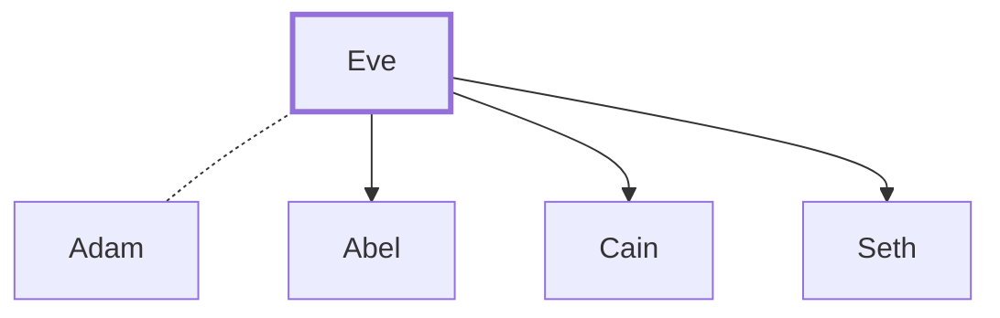

# Eve

First woman; wife of Adam; tempted by the serpent.

**Original-language names:** חַוָּה (H2332) · Εὖα (G2096)

## When

- **Lived:** [[connections/timeline/41st century BC|4004 BC]] – ? *(Jones)*
- **Placed around:** [[connections/timeline/1st century AD|AD 60]] *(Ussher: the median date of the passages naming them)*

## Family

- **Brothers and sisters:** [[connections/people/Adam|Adam]]
- **Spouses:** [[connections/people/Adam|Adam]]
- **Children:** [[connections/people/Abel|Abel]], [[connections/people/Cain|Cain]], [[connections/people/Seth|Seth]]

**Family group:** [[connections/genealogy/Family of Adam|Family of Adam]], generation 1

## Events

- [[connections/timeline/41st century BC|4004 BC]] · [[connections/events/Creation of Adam and Eve|Creation of Adam and Eve]]
- [[connections/timeline/41st century BC|4004 BC]] · [[connections/events/The Fall|The Fall]]
- [[connections/timeline/39th century BC|3874 BC]] · [[connections/events/Birth of Seth|Birth of Seth]]

## Appears in

[[connections/chapters/01-genesis/Genesis 3|Genesis 3]] · [[connections/chapters/01-genesis/Genesis 4|Genesis 4]] · [[connections/chapters/47-2-corinthians/2 Corinthians 11|2 Corinthians 11]] · [[connections/chapters/54-1-timothy/1 Timothy 2|1 Timothy 2]]

## Appears in the same verse as

[[connections/people/Adam|Adam (3)]] · [[connections/people/Cain|Cain]] · [[connections/people/Jesus|Jesus]]
