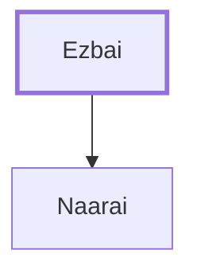

# Ezbai

Father of Naarai, one of David's mighty men.

**Original-language names:** אֶזְבָּ֑י (H0229)

## When

- **Placed around:** [[connections/timeline/11th century BC|1055 BC]] *(Ussher: the median date of the passages naming them)*

## Family

- **Children:** [[connections/people/Naarai|Naarai]]

**Family group:** [[connections/genealogy/Family of Ezbai|Family of Ezbai]], generation 1

## Appears in

[[connections/chapters/13-1-chronicles/1 Chronicles 11|1 Chronicles 11]]

## Appears in the same verse as

[[connections/people/Hezro|Hezro]] · [[connections/people/Naarai|Naarai]]
