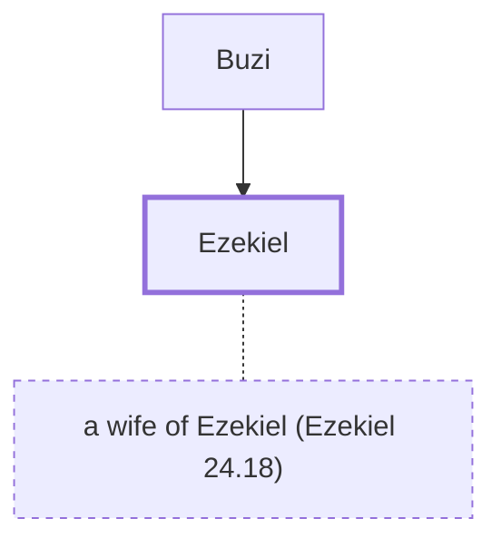

# Ezekiel

Prophet during Babylonian exile; author of the Book of Ezekiel.

**Original-language names:** יְחֶזְקֵאל (H3168)

## When

- **Placed around:** [[connections/timeline/6th century BC|590 BC]] *(Ussher: the median date of the passages naming them)*

## Family

- **Father:** [[connections/people/Buzi|Buzi]]
- **Spouses:** [[connections/people/a wife of Ezekiel (Ezekiel 24.18)|a wife of Ezekiel (Ezekiel 24.18)]]

**Family group:** [[connections/genealogy/Family of Buzi|Family of Buzi]], generation 2

## Events

- [[connections/timeline/6th century BC|593 BC]] · [[connections/events/Prophecies of Ezekiel|Prophecies of Ezekiel]]

## Appears in

[[connections/chapters/26-ezekiel/Ezekiel 1|Ezekiel 1]] · [[connections/chapters/26-ezekiel/Ezekiel 24|Ezekiel 24]]

## Appears in the same verse as

[[connections/people/Buzi|Buzi]] · [[connections/places/Chaldea|Chaldea]] · [[connections/places/Chebar|Chebar]]
