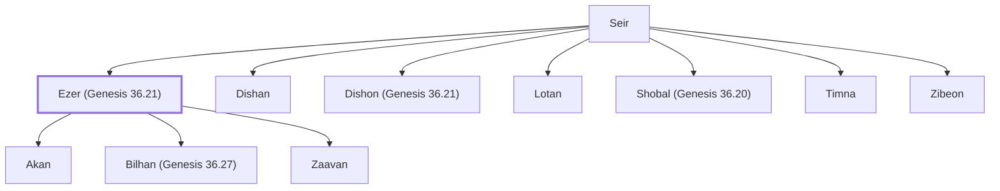

# Ezer (Genesis 36.21)

Horite chief in Seir; son of Seir the Horite.

**Original-language names:** אֵ֫צֶר (H0687)

## When

- **Placed around:** [[connections/timeline/18th century BC|1800 BC]] *(Ussher: the median date of the passages naming them)*

## Family

- **Father:** [[connections/people/Seir|Seir]]
- **Brothers and sisters:** [[connections/people/Dishan|Dishan]], [[connections/people/Dishon (Genesis 36.21)|Dishon (Genesis 36.21)]], [[connections/people/Lotan|Lotan]], [[connections/people/Shobal (Genesis 36.20)|Shobal (Genesis 36.20)]], [[connections/people/Timna|Timna]], [[connections/people/Zibeon|Zibeon]]
- **Children:** [[connections/people/Akan|Akan]], [[connections/people/Bilhan (Genesis 36.27)|Bilhan (Genesis 36.27)]], [[connections/people/Zaavan|Zaavan]]
- **Tribe or nation:** Edom

**Family group:** [[connections/genealogy/Family of Adam|Family of Adam]], generation 2

## Appears in

[[connections/chapters/01-genesis/Genesis 36|Genesis 36 (3)]] · [[connections/chapters/13-1-chronicles/1 Chronicles 1|1 Chronicles 1 (2)]]

## Appears in the same verse as

[[connections/people/Dishan|Dishan (4)]] · [[connections/people/Dishon (Genesis 36.21)|Dishon (Genesis 36.21) (3)]] · [[connections/people/Akan|Akan (2)]] · [[connections/people/Bilhan (Genesis 36.27)|Bilhan (Genesis 36.27) (2)]] · [[connections/people/Seir|Seir (2)]] · [[connections/people/Zaavan|Zaavan (2)]] · [[connections/people/Anah|Anah]] · [[connections/people/Aran|Aran]] · [[connections/people/Esau|Esau]] · [[connections/people/Hori (Genesis 36.22)|Hori (Genesis 36.22)]] · [[connections/people/Lotan|Lotan]] · [[connections/people/Shobal (Genesis 36.20)|Shobal (Genesis 36.20)]] · [[connections/people/Uz (Genesis 36.28)|Uz (Genesis 36.28)]] · [[connections/places/Seir|Seir]]
