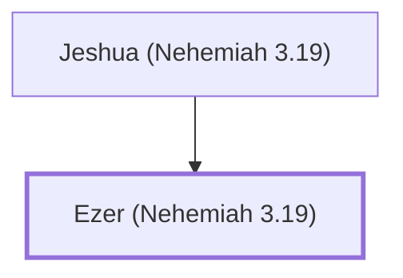

# Ezer (Nehemiah 3.19)

Ruler of Mizpah; repaired a section of Jerusalem's wall.

**Original-language names:** עֵ֫זֶר (H5829)

## When

- **Placed around:** [[connections/timeline/5th century BC|445 BC]] *(Ussher: the median date of the passages naming them)*

## Family

- **Father:** [[connections/people/Jeshua (Nehemiah 3.19)|Jeshua (Nehemiah 3.19)]]

**Family group:** [[connections/genealogy/Family of Jeshua (Nehemiah 3.19)|Family of Jeshua (Nehemiah 3.19)]], generation 2

## Appears in

[[connections/chapters/16-nehemiah/Nehemiah 3|Nehemiah 3]]

## Appears in the same verse as

[[connections/people/Jeshua (Nehemiah 3.19)|Jeshua (Nehemiah 3.19)]] · [[connections/places/Mizpah|Mizpah]]
