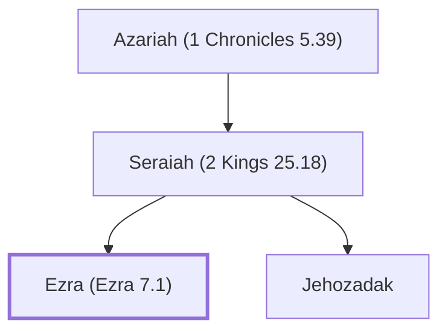

# Ezra (Ezra 7.1)

Priest; scribe; led a group of exiles back to Jerusalem.

**Original-language names:** עֶזְרָא (H5830) · עֶזְרָא (H5831)

## When

- **Placed around:** [[connections/timeline/5th century BC|445 BC]] *(Ussher: the median date of the passages naming them)*

## Family

- **Father:** [[connections/people/Seraiah (2 Kings 25.18)|Seraiah (2 Kings 25.18)]]
- **Brothers and sisters:** [[connections/people/Jehozadak|Jehozadak]]
- **Tribe or nation:** Tribe of Levi

**Line of descent** (49 generations, father to son): [[connections/people/Adam|Adam]] → [[connections/people/Seth|Seth]] → [[connections/people/Enosh|Enosh]] → [[connections/people/Kenan|Kenan]] → [[connections/people/Mahalalel (Genesis 5.12)|Mahalalel (Genesis 5.12)]] → [[connections/people/Jared|Jared]] → [[connections/people/Enoch (Genesis 5.18)|Enoch (Genesis 5.18)]] → [[connections/people/Methuselah|Methuselah]] → [[connections/people/Lamech (Genesis 5.25)|Lamech (Genesis 5.25)]] → [[connections/people/Noah (Genesis 5.29)|Noah (Genesis 5.29)]] → [[connections/people/Shem|Shem]] → [[connections/people/Arpachshad|Arpachshad]] → [[connections/people/Cainan|Cainan]] → [[connections/people/Shelah (Genesis 10.24)|Shelah (Genesis 10.24)]] → [[connections/people/Eber (Genesis 10.21)|Eber (Genesis 10.21)]] → [[connections/people/Peleg|Peleg]] → [[connections/people/Reu|Reu]] → [[connections/people/Serug|Serug]] → [[connections/people/Nahor (Genesis 11.22)|Nahor (Genesis 11.22)]] → [[connections/people/Terah|Terah]] → [[connections/people/Abraham|Abraham]] → [[connections/people/Isaac|Isaac]] → [[connections/people/Israel|Israel]] → [[connections/people/Levi (Genesis 29.34)|Levi (Genesis 29.34)]] → [[connections/people/Kohath|Kohath]] → [[connections/people/Amram (Exodus 6.18)|Amram (Exodus 6.18)]] → [[connections/people/Aaron|Aaron]] → [[connections/people/Eleazar (Exodus 6.23)|Eleazar (Exodus 6.23)]] → [[connections/people/Phinehas (Exodus 6.25)|Phinehas (Exodus 6.25)]] → [[connections/people/Abishua (1 Chronicles 5.30)|Abishua (1 Chronicles 5.30)]] → [[connections/people/Bukki (1 Chronicles 5.31)|Bukki (1 Chronicles 5.31)]] → [[connections/people/Uzzi (1 Chronicles 5.31)|Uzzi (1 Chronicles 5.31)]] → [[connections/people/Zerahiah (1 Chronicles 5.32)|Zerahiah (1 Chronicles 5.32)]] → [[connections/people/Meraioth|Meraioth]] → [[connections/people/Amariah (1 Chronicles 5.33)|Amariah (1 Chronicles 5.33)]] → [[connections/people/Ahitub (2 Samuel 8.17)|Ahitub (2 Samuel 8.17)]] → [[connections/people/Zadok (2 Samuel 8.17)|Zadok (2 Samuel 8.17)]] → [[connections/people/Ahimaaz (2 Samuel 15.27)|Ahimaaz (2 Samuel 15.27)]] → [[connections/people/Azariah (1 Kings 4.2)|Azariah (1 Kings 4.2)]] → [[connections/people/Johanan (1 Chronicles 5.35)|Johanan (1 Chronicles 5.35)]] → [[connections/people/Azariah (1 Chronicles 5.36)|Azariah (1 Chronicles 5.36)]] → [[connections/people/Amariah (1 Chronicles 5.37)|Amariah (1 Chronicles 5.37)]] → [[connections/people/Ahitub (1 Chronicles 5.37)|Ahitub (1 Chronicles 5.37)]] → [[connections/people/Zadok (1 Chronicles 5.38)|Zadok (1 Chronicles 5.38)]] → [[connections/people/Shallum (1 Chronicles 5.38)|Shallum (1 Chronicles 5.38)]] → [[connections/people/Hilkiah (2 Kings 22.4)|Hilkiah (2 Kings 22.4)]] → [[connections/people/Azariah (1 Chronicles 5.39)|Azariah (1 Chronicles 5.39)]] → [[connections/people/Seraiah (2 Kings 25.18)|Seraiah (2 Kings 25.18)]] → **Ezra (Ezra 7.1)**

**Family group:** [[connections/genealogy/Family of Adam|Family of Adam]], generation 49

## Appears in

[[connections/chapters/15-ezra/Ezra 7|Ezra 7 (7)]] · [[connections/chapters/15-ezra/Ezra 10|Ezra 10 (6)]] · [[connections/chapters/16-nehemiah/Nehemiah 8|Nehemiah 8 (7)]] · [[connections/chapters/16-nehemiah/Nehemiah 12|Nehemiah 12 (2)]]

## Appears in the same verse as

[[connections/people/Israel|Israel (8)]] · [[connections/people/Artaxerxes|Artaxerxes (4)]] · [[connections/people/Moses|Moses (2)]] · [[connections/people/Nehemiah (Nehemiah 1.1)|Nehemiah (Nehemiah 1.1) (2)]] · [[connections/places/Euphrates|Euphrates (2)]] · [[connections/people/Anaiah (Nehemiah 8.4)|Anaiah (Nehemiah 8.4)]] · [[connections/people/Azarel (Nehemiah 12.36)|Azarel (Nehemiah 12.36)]] · [[connections/people/Azariah (1 Chronicles 5.39)|Azariah (1 Chronicles 5.39)]] · [[connections/people/David|David]] · [[connections/people/Elam (Ezra 2.7)|Elam (Ezra 2.7)]] · [[connections/people/Eliashib (Ezra 10.6)|Eliashib (Ezra 10.6)]] · [[connections/people/Gilalai|Gilalai]] · [[connections/people/Hanani (Nehemiah 12.36)|Hanani (Nehemiah 12.36)]] · [[connections/people/Hashbaddanah|Hashbaddanah]] · [[connections/people/Hashum (Nehemiah 8.4)|Hashum (Nehemiah 8.4)]] · [[connections/people/Hilkiah (2 Kings 22.4)|Hilkiah (2 Kings 22.4)]] · [[connections/people/Hilkiah (Nehemiah 8.4)|Hilkiah (Nehemiah 8.4)]] · [[connections/people/Jehiel (Ezra 10.2)|Jehiel (Ezra 10.2)]] · [[connections/people/Jehohanan (Ezra 10.6)|Jehohanan (Ezra 10.6)]] · [[connections/people/Jehozadak|Jehozadak]] · [[connections/people/Joiakim|Joiakim]] · [[connections/people/Joshua (Ezra 2.2)|Joshua (Ezra 2.2)]] · [[connections/people/Judah (Nehemiah 12.36)|Judah (Nehemiah 12.36)]] · [[connections/people/Maai|Maai]] · [[connections/people/Maaseiah (Nehemiah 8.4)|Maaseiah (Nehemiah 8.4)]] · [[connections/people/Malchijah (Nehemiah 8.4)|Malchijah (Nehemiah 8.4)]] · [[connections/people/Mattithiah (Nehemiah 8.4)|Mattithiah (Nehemiah 8.4)]] · [[connections/people/Meshullam (Nehemiah 8.4)|Meshullam (Nehemiah 8.4)]] · [[connections/people/Milalai|Milalai]] · [[connections/people/Mishael (Nehemiah 8.4)|Mishael (Nehemiah 8.4)]] · [[connections/people/Nethanel (Nehemiah 12.36)|Nethanel (Nehemiah 12.36)]] · [[connections/people/Pedaiah (Nehemiah 8.4)|Pedaiah (Nehemiah 8.4)]] · [[connections/people/Seraiah (2 Kings 25.18)|Seraiah (2 Kings 25.18)]] · [[connections/people/Shecaniah (Ezra 10.2)|Shecaniah (Ezra 10.2)]] · [[connections/people/Shema (Nehemiah 8.4)|Shema (Nehemiah 8.4)]] · [[connections/people/Shemaiah (Nehemiah 12.36)|Shemaiah (Nehemiah 12.36)]] · [[connections/people/Uriah (Nehemiah 8.4)|Uriah (Nehemiah 8.4)]] · [[connections/people/Zechariah (Nehemiah 8.4)|Zechariah (Nehemiah 8.4)]] · [[connections/places/Babylon|Babylon]] · [[connections/places/Persia|Persia]] · [[connections/places/Water Gate|Water Gate]]
