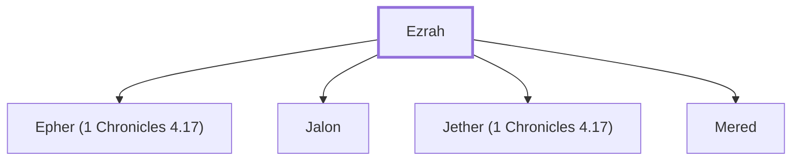

# Ezrah

Son of Chelub; mentioned in Judah's genealogy.

**Original-language names:** עֶזְרָה (H5834)

## When

- **Placed around:** [[connections/timeline/18th century BC|1721 BC]] *(Ussher: the median date of the passages naming them)*

## Family

- **Children:** [[connections/people/Epher (1 Chronicles 4.17)|Epher (1 Chronicles 4.17)]], [[connections/people/Jalon|Jalon]], [[connections/people/Jether (1 Chronicles 4.17)|Jether (1 Chronicles 4.17)]], [[connections/people/Mered|Mered]]
- **Tribe or nation:** Tribe of Judah(?)

**Family group:** [[connections/genealogy/Family of Adam|Family of Adam]], generation 1

## Appears in

[[connections/chapters/13-1-chronicles/1 Chronicles 4|1 Chronicles 4]]

## Appears in the same verse as

[[connections/people/Epher (1 Chronicles 4.17)|Epher (1 Chronicles 4.17)]] · [[connections/people/Ishbah|Ishbah]] · [[connections/people/Jalon|Jalon]] · [[connections/people/Jether (1 Chronicles 4.17)|Jether (1 Chronicles 4.17)]] · [[connections/people/Mered|Mered]] · [[connections/people/Miriam (1 Chronicles 4.17)|Miriam (1 Chronicles 4.17)]] · [[connections/people/Shammai (1 Chronicles 4.17)|Shammai (1 Chronicles 4.17)]] · [[connections/places/Eshtemoa|Eshtemoa]]
