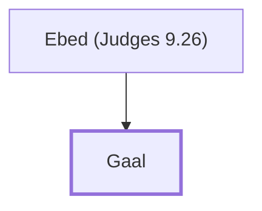

# Gaal

Son of Ebed; led a revolt against Abimelech.

**Original-language names:** גַּ֫עַל (H1603)

## When

- **Placed around:** [[connections/timeline/13th century BC|1233 BC]] *(Ussher: the median date of the passages naming them)*

## Family

- **Father:** [[connections/people/Ebed (Judges 9.26)|Ebed (Judges 9.26)]]

**Family group:** [[connections/genealogy/Family of Ebed (Judges 9.26)|Family of Ebed (Judges 9.26)]], generation 2

## Appears in

[[connections/chapters/07-judges/Judges 9|Judges 9 (9)]]

## Appears in the same verse as

[[connections/people/Abimelech (Judges 8.31)|Abimelech (Judges 8.31) (5)]] · [[connections/people/Ebed (Judges 9.26)|Ebed (Judges 9.26) (5)]] · [[connections/places/Shechem|Shechem (5)]] · [[connections/people/Zebul|Zebul (4)]] · [[connections/people/Gideon|Gideon]] · [[connections/people/Hamor|Hamor]] · [[connections/places/Arumah|Arumah]] · [[connections/places/Diviners' Oak|Diviners' Oak]]
