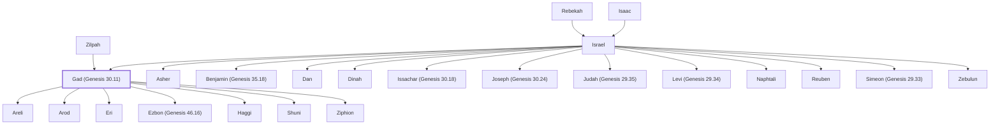

# Gad (Genesis 30.11)

Israelite tribe; descended from Gad, son of Jacob.

**Original-language names:** גָּד (H1410) · גָּדִי (H1425) · Γάδ (G1045)

## When

- **Lived:** [[connections/timeline/18th century BC|1753 BC]] – ? *(Jones)*
- **Placed around:** [[connections/timeline/15th century BC|1444 BC]] *(Ussher: the median date of the passages naming them)*

## Family

- **Father:** [[connections/people/Israel|Israel]]
- **Mother:** [[connections/people/Zilpah|Zilpah]]
- **Brothers and sisters:** [[connections/people/Asher|Asher]], [[connections/people/Benjamin (Genesis 35.18)|Benjamin (Genesis 35.18)]], [[connections/people/Dan|Dan]], [[connections/people/Dinah|Dinah]], [[connections/people/Issachar (Genesis 30.18)|Issachar (Genesis 30.18)]], [[connections/people/Joseph (Genesis 30.24)|Joseph (Genesis 30.24)]], [[connections/people/Judah (Genesis 29.35)|Judah (Genesis 29.35)]], [[connections/people/Levi (Genesis 29.34)|Levi (Genesis 29.34)]], [[connections/people/Naphtali|Naphtali]], [[connections/people/Reuben|Reuben]], [[connections/people/Simeon (Genesis 29.33)|Simeon (Genesis 29.33)]], [[connections/people/Zebulun|Zebulun]]
- **Children:** [[connections/people/Areli|Areli]], [[connections/people/Arod|Arod]], [[connections/people/Eri|Eri]], [[connections/people/Ezbon (Genesis 46.16)|Ezbon (Genesis 46.16)]], [[connections/people/Haggi|Haggi]], [[connections/people/Shuni|Shuni]], [[connections/people/Ziphion|Ziphion]]
- **Tribe or nation:** Tribe of Gad

**Line of descent** (24 generations, father to son): [[connections/people/Adam|Adam]] → [[connections/people/Seth|Seth]] → [[connections/people/Enosh|Enosh]] → [[connections/people/Kenan|Kenan]] → [[connections/people/Mahalalel (Genesis 5.12)|Mahalalel (Genesis 5.12)]] → [[connections/people/Jared|Jared]] → [[connections/people/Enoch (Genesis 5.18)|Enoch (Genesis 5.18)]] → [[connections/people/Methuselah|Methuselah]] → [[connections/people/Lamech (Genesis 5.25)|Lamech (Genesis 5.25)]] → [[connections/people/Noah (Genesis 5.29)|Noah (Genesis 5.29)]] → [[connections/people/Shem|Shem]] → [[connections/people/Arpachshad|Arpachshad]] → [[connections/people/Cainan|Cainan]] → [[connections/people/Shelah (Genesis 10.24)|Shelah (Genesis 10.24)]] → [[connections/people/Eber (Genesis 10.21)|Eber (Genesis 10.21)]] → [[connections/people/Peleg|Peleg]] → [[connections/people/Reu|Reu]] → [[connections/people/Serug|Serug]] → [[connections/people/Nahor (Genesis 11.22)|Nahor (Genesis 11.22)]] → [[connections/people/Terah|Terah]] → [[connections/people/Abraham|Abraham]] → [[connections/people/Isaac|Isaac]] → [[connections/people/Israel|Israel]] → **Gad (Genesis 30.11)**

**Family group:** [[connections/genealogy/Family of Adam|Family of Adam]], generation 24

## Events

- [[connections/timeline/18th century BC|1753 BC]] · [[connections/events/Birth of Gad|Birth of Gad]]
- [[connections/timeline/18th century BC|1728 BC]] · [[connections/events/Joseph sold to Egypt|Joseph sold to Egypt]]
- [[connections/timeline/18th century BC|1708 BC]] · [[connections/events/7 years of famine|7 years of famine]]
- [[connections/timeline/18th century BC|1706 BC]] · [[connections/events/Joseph's brothers return to Egypt|Joseph's brothers return to Egypt]]

## Appears in

[[connections/chapters/01-genesis/Genesis 30|Genesis 30]] · [[connections/chapters/01-genesis/Genesis 35|Genesis 35]] · [[connections/chapters/01-genesis/Genesis 46|Genesis 46]] · [[connections/chapters/01-genesis/Genesis 49|Genesis 49]] · [[connections/chapters/02-exodus/Exodus 1|Exodus 1]] · [[connections/chapters/04-numbers/Numbers 1|Numbers 1 (3)]] · [[connections/chapters/04-numbers/Numbers 2|Numbers 2]] · [[connections/chapters/04-numbers/Numbers 7|Numbers 7]] · [[connections/chapters/04-numbers/Numbers 10|Numbers 10]] · [[connections/chapters/04-numbers/Numbers 13|Numbers 13]] · [[connections/chapters/04-numbers/Numbers 26|Numbers 26 (2)]] · [[connections/chapters/04-numbers/Numbers 32|Numbers 32 (8)]] · [[connections/chapters/04-numbers/Numbers 34|Numbers 34]] · [[connections/chapters/05-deuteronomy/Deuteronomy 27|Deuteronomy 27]] · [[connections/chapters/05-deuteronomy/Deuteronomy 33|Deuteronomy 33]] · [[connections/chapters/06-joshua/Joshua 4|Joshua 4]] · [[connections/chapters/06-joshua/Joshua 13|Joshua 13 (2)]] · [[connections/chapters/06-joshua/Joshua 18|Joshua 18]] · [[connections/chapters/06-joshua/Joshua 20|Joshua 20]] · [[connections/chapters/06-joshua/Joshua 21|Joshua 21 (2)]] · [[connections/chapters/06-joshua/Joshua 22|Joshua 22 (12)]] · [[connections/chapters/09-1-samuel/1 Samuel 13|1 Samuel 13]] · [[connections/chapters/10-2-samuel/2 Samuel 24|2 Samuel 24]] · [[connections/chapters/13-1-chronicles/1 Chronicles 2|1 Chronicles 2]] · [[connections/chapters/13-1-chronicles/1 Chronicles 5|1 Chronicles 5]] · [[connections/chapters/13-1-chronicles/1 Chronicles 6|1 Chronicles 6 (2)]] · [[connections/chapters/24-jeremiah/Jeremiah 49|Jeremiah 49]] · [[connections/chapters/26-ezekiel/Ezekiel 48|Ezekiel 48 (3)]] · [[connections/chapters/66-revelation/Revelation 7|Revelation 7]]

## Appears in the same verse as

[[connections/people/Reuben|Reuben (26)]] · [[connections/people/Manasseh (Genesis 41.51)|Manasseh (Genesis 41.51) (13)]] · [[connections/people/Israel|Israel (11)]] · [[connections/places/Gilead|Gilead (10)]] · [[connections/people/Moses|Moses (9)]] · [[connections/places/Jordan|Jordan (8)]] · [[connections/people/Asher|Asher (5)]] · [[connections/people/Deuel|Deuel (4)]] · [[connections/people/Eleazar (Exodus 6.23)|Eleazar (Exodus 6.23) (4)]] · [[connections/people/Eliasaph (Numbers 1.14)|Eliasaph (Numbers 1.14) (4)]] · [[connections/people/Naphtali|Naphtali (4)]] · [[connections/people/Phinehas (Exodus 6.25)|Phinehas (Exodus 6.25) (4)]] · [[connections/people/Zebulun|Zebulun (4)]] · [[connections/places/Canaan|Canaan (4)]] · [[connections/places/Bashan|Bashan (3)]] · [[connections/places/Gilgal (Deuteronomy 11.30)|Gilgal (Deuteronomy 11.30) (3)]] · [[connections/places/Ramoth|Ramoth (3)]] · [[connections/people/Haggi|Haggi (2)]] · [[connections/people/Joseph (Genesis 30.24)|Joseph (Genesis 30.24) (2)]] · [[connections/people/Leah|Leah (2)]] · [[connections/people/Merari|Merari (2)]] · [[connections/people/Shuni|Shuni (2)]] · [[connections/people/Ziphion|Ziphion (2)]] · [[connections/places/Aroer (Numbers 32.34)|Aroer (Numbers 32.34) (2)]] · [[connections/places/Dan|Dan (2)]] · [[connections/places/Jazer|Jazer (2)]] · [[connections/places/Mahanaim|Mahanaim (2)]] · [[connections/people/Areli|Areli]] · [[connections/people/Arod|Arod]] · [[connections/people/Benjamin (Genesis 35.18)|Benjamin (Genesis 35.18)]] · [[connections/people/Dan|Dan]] · [[connections/people/Eri|Eri]] · [[connections/people/Ezbon (Genesis 46.16)|Ezbon (Genesis 46.16)]] · [[connections/people/Geuel|Geuel]] · [[connections/people/Judah (Genesis 29.35)|Judah (Genesis 29.35)]] · [[connections/people/Machi|Machi]] · [[connections/people/Og|Og]] · [[connections/people/Saul|Saul]] · [[connections/people/Sihon|Sihon]] · [[connections/people/Zilpah|Zilpah]] · [[connections/places/Ammon|Ammon]] · [[connections/places/Ataroth (Numbers 32.3)|Ataroth (Numbers 32.3)]] · [[connections/places/Bezer|Bezer]] · [[connections/places/Brook of Egypt|Brook of Egypt]] · [[connections/places/Dibon (Numbers 21.30)|Dibon (Numbers 21.30)]] · [[connections/places/Ebal Mount|Ebal Mount]] · [[connections/places/Golan|Golan]] · [[connections/places/Great Sea|Great Sea]] · [[connections/places/Jericho|Jericho]] · [[connections/places/Meribah (Numbers 20.13)|Meribah (Numbers 20.13)]] · [[connections/places/Paddan|Paddan]] · [[connections/places/Salecah|Salecah]] · [[connections/places/Shiloh|Shiloh]] · [[connections/places/Tamar|Tamar]]
