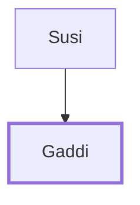

# Gaddi

Son of Susi; representative of Manasseh among the spies.

**Original-language names:** גַּדִּי (H1426)

## When

- **Placed around:** [[connections/timeline/15th century BC|1490 BC]] *(Ussher: the median date of the passages naming them)*

## Family

- **Father:** [[connections/people/Susi|Susi]]

**Family group:** [[connections/genealogy/Family of Susi|Family of Susi]], generation 2

## Appears in

[[connections/chapters/04-numbers/Numbers 13|Numbers 13]]

## Appears in the same verse as

[[connections/people/Joseph (Genesis 30.24)|Joseph (Genesis 30.24)]] · [[connections/people/Manasseh (Genesis 41.51)|Manasseh (Genesis 41.51)]] · [[connections/people/Susi|Susi]]
